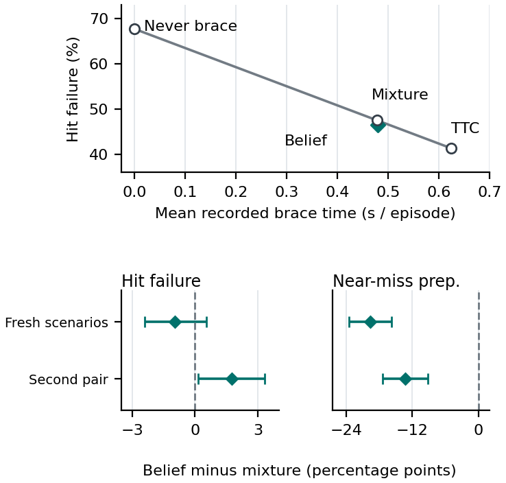
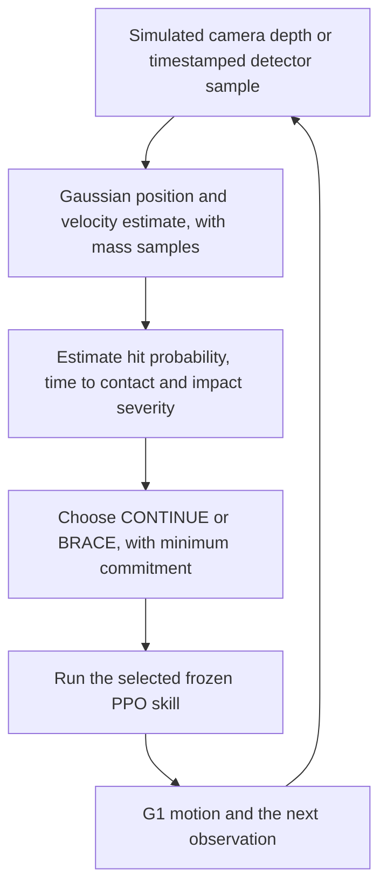
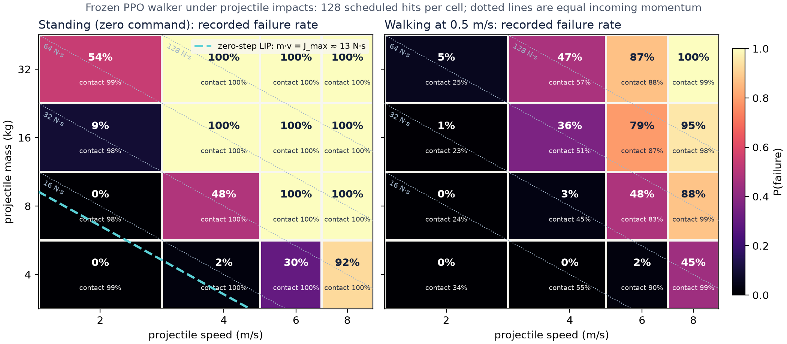
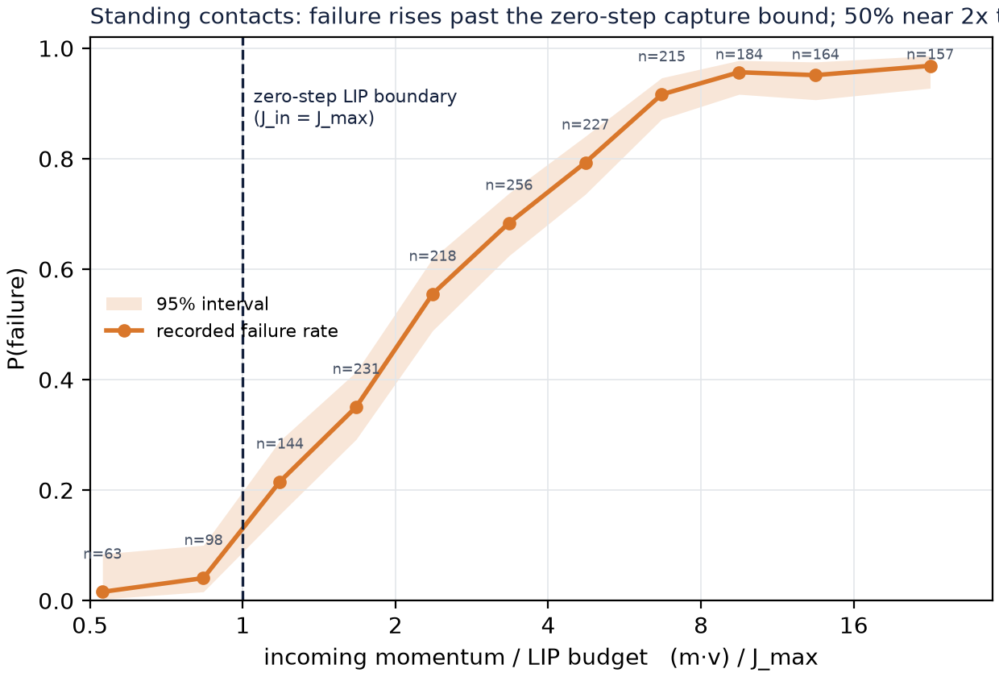
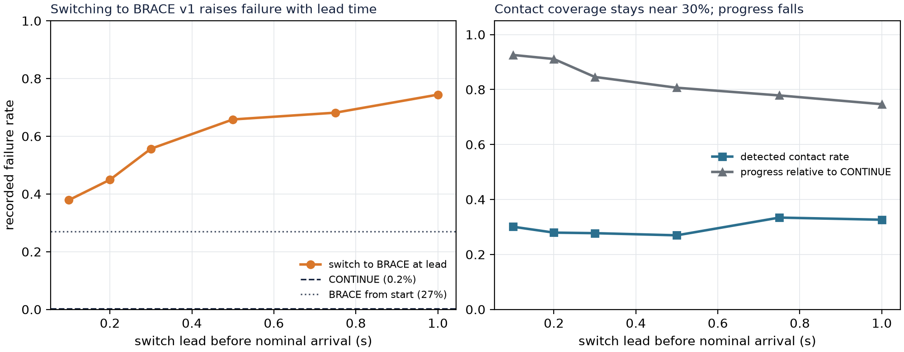
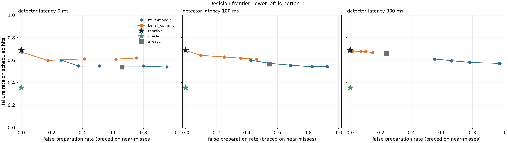

# Foresight: latency-aware anticipatory bracing for a humanoid

**When should a walking humanoid interrupt locomotion to brace for an impact it can see only
late, noisily, and without knowing how heavy the object is?**

AA228/CS238 (Decision Making under Uncertainty) final project, Stanford, Autumn 2026.
Simulation only: Unitree G1 in MuJoCo Playground (rss2025, MJX + MuJoCo-Warp), frozen PPO
skills, a POMDP decision layer on top. Author: Prasuna Chatla.

## When is an interruption worth it?

A robot can prevent falls by bracing more often, but every brace interrupts its walk. We compared two ways to spend the same average preparation time. A belief rule uses each object's uncertain path and expected impact to decide when to brace. The baseline tosses a coin once per encounter. If enabled, an ordinary time-to-contact (TTC) rule still uses the detections to choose when to brace. The frequency of enabling TTC was set on a separate development set.



At 10 Hz with 100 ms added delay, the belief rule spent **0.480 s** braced per encounter, against **0.478 s** for the baseline in expectation. It braced on **26.68%** of scheduled near-misses, compared with **46.28%** for the baseline. On intended hits, **46.55%** failed with the belief rule and **47.50%** with the baseline. The paired 95% interval for the difference in hit failures spans zero. On a second trained skill pair, the belief rule also prepared on fewer near-misses, but more intended hits ended in failure. These are simulations. The archive counts recorded brace time, which can include steps after termination.

[Read the six-page paper](paper/foresight.pdf) · [Reproduce these results on CPU](analysis/decision_tradeoff/) · [Inspect the archived episode evidence](docs/SESSION_G_REVIEW.md)

**Engineering resources.** [Controller inventory](docs/technical_notes/controllers_and_freezing.md) · [Numerical precision in closed-loop evaluation](docs/technical_notes/numerical_precision.md) · [Technical notes](docs/technical_notes/README.md).

---

## 1. Problem statement

A humanoid walking at a commanded velocity sees an object approaching through delayed, noisy and
intermittent detections. It does not know whether the object will hit, when, from which direction,
or how hard, and the object's **mass is not observable** from images at all. The robot has two
options at every decision step:

| Action | What it buys | What it costs |
|---|---|---|
| **CONTINUE** | keeps tracking the velocity command; recovery is left to the walking controller | nothing now; a fall if the impact exceeds what reactive balance can absorb |
| **BRACE** | a preparatory posture (lower CoM, wider stance, both feet planted) that raises the impulse the robot can absorb | forward progress; a 300 ms minimum commitment; paid in full if the object misses |

Preparing too early wastes the cost; preparing too late leaves no time for the posture to form
(τ_brace). Waiting buys information but shortens the time left to act. The decision is therefore
**sequential, belief-dependent, and commitment-constrained**, which is the structure of a POMDP.

## 2. How the problem is solved

The modular controller uses the same frozen walking and bracing skills for each decision rule. PPO supplies the actions that move the humanoid. The comparison changes who decides when to switch skills.



The Gaussian filter accounts for a detection's capture time under its constant-velocity flight model. Mass remains unobserved and is integrated over its assumed prior. The threshold acts on estimated time to contact. The lead-conditioned belief rule also estimates how much a brace could reduce failure given the available time to prepare. Its response model was fitted to the privileged timing trials. The capture-point calculation is a separate standing-balance reference. In the reported held-out comparison, detections arrive at 10 Hz and the simulated control period is 20 ms. [Method and experiment definitions](paper/foresight.tex)

## 3. Methods available, and why this one

| Method | What it does | Why not (or not first) |
|---|---|---|
| Reactive only | rely on the walking controller's push recovery | the baseline every method must beat; no anticipation |
| Always prepare on detection | brace whenever anything is seen | pays the preparation cost on every near-miss; the "cost of excessive preparation" baseline |
| Time-to-contact threshold on the point estimate | brace when the estimated TTC drops below a tuned value | ignores uncertainty and mass ambiguity; strong, simple baseline |
| **Belief-weighted myopic commit rule** (chosen first) | expected cost of brace-now vs continue under the belief | cheap, derivable, uses the full belief incl. the mass mixture; never values waiting for a better look |
| QMDP | Bellman backups on a reduced model, then belief-weighted action values | adds lookahead over the reduced dynamics; still assumes uncertainty vanishes next step |
| POMCP | observation-dependent lookahead by Monte-Carlo tree search | real-time budget is tight at 10 Hz; stretch comparison for whether waiting ever helps |
| Learned gate (DQN on belief features) | learn the switch from data | needs the same belief anyway; useful ablation of model vs learning |
| End-to-end PPO with the object in the observation | one policy, no explicit belief | the reviewer's question: does the modular layer earn its place? evaluated separately in E14 |

The initial experiments used the myopic commit rule because every term in it is either a belief statistic, a
cost, or an LIP quantity, so its behaviour is interpretable, its failure modes are diagnosable,
and it answers the thesis question directly: *does acting on the belief (including mass
ambiguity) beat acting on a point estimate, and does the gap grow with perception latency?*
QMDP, POMCP and the learned gate were considered during planning. The final held-out comparison evaluated TTC, lead-conditioned belief, blind waiting, and one-step observation lookahead.

## 4. Experiments

Three GPU sessions, each preceded by a code drop that is run on CPU against the real environment.

| # | Experiment | Session | Produces |
|---|---|---|---|
| E1 | Nominal walker, 3 seeds, 200M PPO steps each | A (done) | reward curves |
| E2 | Reactive fall-rate surface over projectile (mass, speed), walking and standing | A (done) | `results/E2*/grid.csv`, Figure 1 |
| E3 | Zero-step LIP capture-point reference vs E2 | A (done) | `results/E3*/`, Figure 2 |
| E4 | Contact validation with the base pinned: aim, timing, transferred impulse | A (done) | `results/E4_contact/` |
| E5 | BRACE skill (v1) | A (done) | checkpoint |
| E6 | Oracle lead-time test: privileged switch to BRACE at several leads, paired scenarios | A (done) | Figure 3 |
| E6a | Transition diagnostics: switch to BRACE vs zero-command walker, with and without projectile | B | isolates whether the switch itself fails |
| E2d/E3d | Walking fall surface in the heavy regime with the led aim, and its LIP overlay | B | corrected Figure 1 |
| E5b | BRACE v2, trained from walking states (walker hands over after 0–2 s), impacts present | B | checkpoint, τ_brace |
| E6b | Oracle lead-time curve with BRACE v2 on shared replayed trajectories | B | **the gate** for the belief layer |
| E7 | Depth-render pilot: MJX-Warp batch ray-tracer inside the walking loop | C (done) | GO: 42 ms per batch of 64 at 64×64 |
| E10 | Decision frontier: reactive, always-brace, TTC threshold sweep, belief rule sweep, oracle; latency 0/100/300 ms at 10 Hz | C (done) | headline figure |
| E8 | Observation model measured from rendered depth: geometric detector, noise vs range, detection rate, usable FOV | D | replaces the assumed detector numbers |
| E11 | The frontier at 25 Hz and 50 Hz detections, same paired scenarios | D | rate × latency grid, crossover rate |
| E9 | Belief calibration: reliability diagram, time-to-hit error, when the belief resolves | D | is the belief wrong, or merely late |
| E12 | Oracle-gap ladder: reactive → 10 Hz → 50 Hz → perfect sensing → oracle | E | shares of the gap due to rate, noise, rule |
| E13 | Ablations at 50 Hz: commitment window, τ_brace, mass prior | E | ablation table |
| E14 | Object-aware PPO walker (detections as inputs, heavy impacts in training), matched observation model | E | end-to-end baseline |

Scripts: `scripts/run_session_{a,b,c,d,e}.sh` run a session end to end, save results under
`results/`, and push; `scripts/start.sh <letter>` is the one-command pod entry (bootstrap, tmux,
finish_and_stop). Individual tools: `train_skill.py`, `eval_fall_rate.py`, `lip_overlay.py`,
`validate_contact.py`, `eval_oracle_brace.py`, `eval_decision_frontier.py`, `fit_response_model.py`,
`depth_pilot.py`, `depth_detector.py`, `calibration.py`, `plot_rate_sweep.py`, `oracle_gap.py`,
`plot_fall_surfaces.py`, `save_run.py`.

## 5. Early results (Sessions A–C)



*Figure 1. Recorded failure rate of the frozen walker, standing (left) and walking (right),
128 scheduled hits per cell, contact rate in each cell. Dotted lines are equal incoming
momentum; the dashed line is the zero-step LIP reference.*

* **Regime.** On the proposed range (1–8 kg, 1–4 m/s) the walker failed in 0.46% of 4,096
  scheduled hits (1.40% of the 1,285 that made contact). From 4–32 kg at 2–8 m/s the surface is
  graded. Standing is more fragile than walking in 13 of 16 cells.
* **Momentum is not the whole story.** At the same 32 N·s: 4 kg at 8 m/s fails 92%, 8 kg at
  4 m/s 48%, 16 kg at 2 m/s 9% (standing, contact in every trial). The slow-heavy-vs-fast-light
  mechanism is a hypothesis until transferred impulse and contact duration are measured.



*Figure 2. Standing contacts binned by incoming momentum over the LIP budget (Wilson 95%
intervals). Failure is 21% just past the zero-step boundary and 50% near twice the budget.*

* **LIP.** Median budget 13.1 N·s at a median CoM height of 0.671 m; 73.6% agreement with the
  recorded outcome on 2,041 contacts (always-fail baseline 64.9%), detecting 1,320 of 1,325
  failures but flagging 534 of 716 survivors. A screening feature, not a bound.



*Figure 3. BRACE v1 oracle test on 512 paired scenarios per condition.*

* **BRACE v1 fails the gate.** Switching to it at 0.1–1.0 s before nominal arrival raised the
  failure rate from 0.2% (CONTINUE) to 38–74%, rising with lead; at 0.5 s lead, 270 of 337
  failures occurred with no detected contact. The policy was trained from near-standing resets;
  the switch from walking is the suspected cause, to be isolated by E6a.
* **Confounds found and fixed (Session B):** the projectile was aimed at the pelvis at launch
  and the walker walked out of its path (contact ~30%); comparisons now replay one world-space
  trajectory across policies; the evaluator chose the BRACE action one step before the command
  observation changed; readiness is now a sustained posture-and-support criterion.
* **The corrected gate passes with BRACE v2** (`results/E6b_oracle_v2`). Without a projectile,
  switching to either BRACE policy fails 0–3%, so the first-round failures were the evaluator's
  lag. With the projectile (4–16 kg, 3–8 m/s, 512 paired scenarios per cell, contact 98–100%),
  failure given contact at 0.1/0.2/0.3/0.5 s lead: CONTINUE 0.70 throughout; zero-command walker
  0.69–0.70; BRACE v2 0.64/0.60/0.50/0.42. Stopping alone does nothing; the posture protects
  once it has τ_brace ≈ 0.22 s to form. Preparation costs 0.49 m of 2.55 m progress on a miss.



*Figure 4. Decision frontier at 10 Hz detections (E10): failure rate on scheduled hits vs
false-preparation rate on near-misses, one panel per latency; lower-left is better.*

* **First frontier (E10):** reactive 0.69, oracle 0.36; the time-to-contact threshold reaches
  0.55 at 37–51% false preparations; the belief rule is the most selective (0.60 at 18%) but never
  goes lower in this early sweep. Later calibration and release-rule ablations traced a substantial part of the shortfall to switching back to walking before contact.
* **Note on training ranges.** The committed skills were trained with the projectile mass
  randomized over the nominal 1–8 kg for every skill (one shared randomizer); they are evaluated at
  4–16 kg. Each skill now has its own randomizer with its config's range (`foresight/skills/register.py`).

## 6. Evidence and remaining work

| Question | Evidence |
| --- | --- |
| Does preparation help? | On 1,433 intended hits per trained skill pair, a fixed 0.5 s privileged lead reduced failures from 68.60% to 35.59% for pair 1 and from 67.55% to 46.89% for pair 2. |
| Why did the first rules underperform? | The initial rule reused its start condition when deciding whether to stay braced. The release ablation and subsequent fixes are documented in the paper. |
| How much does selectivity cost? | On 2,048 held-out encounters the always-enabled 0.3 s TTC controller had 73 fewer falls than the lead-conditioned belief rule and braced on 216 more scheduled near-misses. The CPU analysis above compares both with an episode-randomized baseline at similar average preparation time. |
| Does the perception chain run online? | In the E17b simulated depth scene, TTC failed on 131/367 intended hits versus 113/367 under parametric sensing. The parked object was visible before launch. Session H passed both small depth checks, then stopped during the hold check. |
| What experiment could change the conclusion? | Compare belief with a single deterministic TTC threshold tuned on separate calibration episodes for equal *pre-termination* brace time. Evaluate the frozen threshold on fresh seeds and report risk together with the achieved budget match. |

[Course manuscript](paper/foresight.pdf) · [Run-by-run audit](docs/SESSION_G_REVIEW.md) · [Session H stage report](https://github.com/pchatla-arch/anticipatory-balance/blob/1d9ee6d3493f58db22954bd0d5c5fe7944826405/results/session_h_20261115T211850Z_1f77c1/report.md)

Results are committed as small files under `results/<run>/` (`save_run.py`: eval curves, configs,
console logs, `summary.json`); the final checkpoints are committed under `checkpoints/<tag>/`.

---

## Repository layout
```
foresight/envs/g1_impact/   ImpactJoystick: Playground G1 joystick + launched projectile, BRACE reward, handover
foresight/lip/              linear inverted pendulum / capture point (J_max, predicted fall)
foresight/eval/rollout.py   checkpoint loading, batched paired rollouts, mode switching, episode tables
foresight/skills/           env registration for Playground's PPO trainer (G1Impact, G1ImpactBrace)
foresight/perception/ belief/ decision/   detector, filter and rule implementations
scripts/                    train_skill, eval_*, lip_overlay, validate_contact, plot_fall_surfaces, run_session_*.sh
tests/                      LIP tests, parent-shim test, dummy checkpoint for CPU smoke tests
```

## Install (GPU pod)
```bash
cd /workspace
curl -LsSf https://astral.sh/uv/install.sh | sh && source ~/.local/bin/env
git clone https://github.com/google-deepmind/mujoco_playground.git
cd mujoco_playground/rss2025 && uv venv --python 3.12 && source .venv/bin/activate
uv --no-config sync --all-extras && uv pip install tensorboardX matplotlib
git clone --filter=blob:none --no-checkout https://github.com/deepmind/mujoco_menagerie.git mujoco_menagerie
cd mujoco_menagerie && git sparse-checkout set unitree_g1 && git checkout -q 1b86ece576591213e2b666ebf59508454200ca97 && cd ..
cd /workspace && git clone https://github.com/pchatla-arch/anticipatory-balance.git && cd anticipatory-balance
python -c "import jax; print(jax.devices())"        # expect CudaDevice
bash scripts/run_session_a.sh 2>&1 | tee logs/session_a.txt
```
The session scripts set `PYTHONPATH`, `JAX_DEFAULT_MATMUL_PRECISION=highest` and unset
`LD_LIBRARY_PATH`/`MUJOCO_GL` themselves; `--num_videos 0` because the pod has no OpenGL.

## Env semantics
Scenario fields (`proj_mass`, `proj_speed`, `proj_momentum = m·v`, `proj_is_miss`,
`t_hit_nominal`) are sampled inputs; outcome fields (`impact_contact`, `contact_step`, `fell`,
`term_reason`, `term_step`) are measured. `fell` is the recorded failure flag: Playground's
termination (inversion, self-contact, NaN) or sustained torso tilt. The scenario is resampled
at every episode start under Playground's autoreset; the launch is timed so the nominal arrival
falls in `hit_time_range`; the aim leads the pelvis by its velocity times the flight time;
`proj_launch_fixed` replays a stored trajectory; `info["brace_active"]` is the external mode
switch (zero command + BRACE policy). The projectile is gravity-compensated (straight flight).
