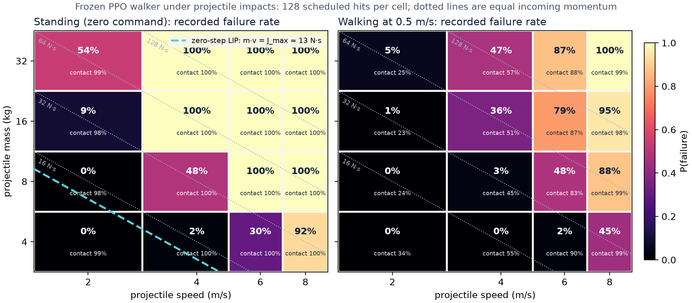
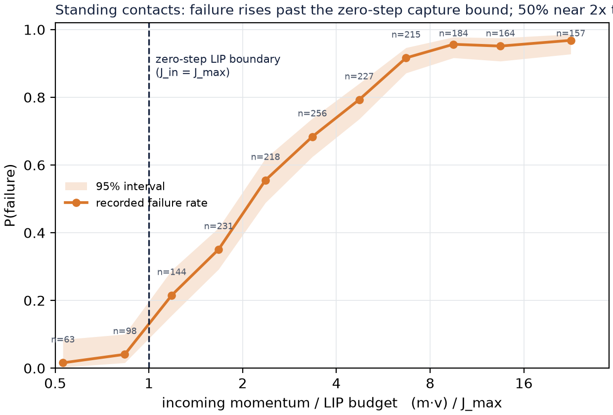
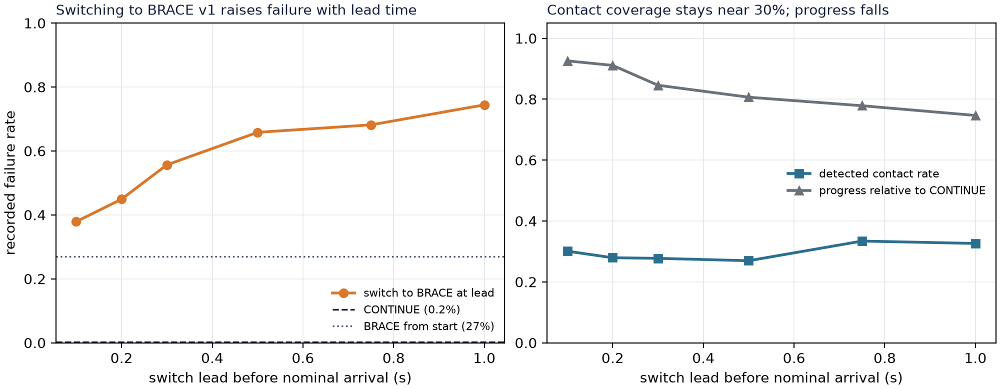

# Foresight: latency-aware anticipatory bracing for a humanoid

**When should a walking humanoid interrupt locomotion to brace for an impact it can see only
late, noisily, and without knowing how heavy the object is?**

AA228/CS238 (Decision Making under Uncertainty) final project, Stanford, Autumn 2026.
Simulation only: Unitree G1 in MuJoCo Playground (rss2025, MJX + MuJoCo-Warp), frozen PPO
skills, a POMDP decision layer on top. Author: Prasuna Chatla.

Status at a glance (Nov 13): infrastructure complete; four policies trained; the first
evaluation pass located the disturbance regime, produced a capture-point reference, and showed
that the first BRACE skill fails when switched into from walking. The corrected preparation gate
is the next run (`scripts/run_session_b.sh`). Details in [Where we are](#where-we-are).

---

## 1. Problem statement

A humanoid walking at a commanded velocity sees an object approaching through delayed, noisy and
intermittent detections. It does not know whether the object will hit, when, from which direction,
or how hard, and the object's **mass is not observable** from images at all. The robot has two
options at every decision step:

| Action | What it buys | What it costs |
|---|---|---|
| **CONTINUE** | keeps tracking the velocity command; recovery is left to the walking controller | nothing now; a fall if the impact exceeds what reactive balance can absorb |
| **BRACE** | a preparatory posture (lower CoM, wider stance, both feet planted) that raises the impulse the robot can absorb | forward progress; a 300 ms minimum commitment; paid in full if the object misses |

Preparing too early wastes the cost; preparing too late leaves no time for the posture to form
(τ_brace). Waiting buys information but shortens the time left to act. The decision is therefore
**sequential, belief-dependent, and commitment-constrained**, which is the structure of a POMDP.

## 2. How the problem is solved

The problem is split into layers so that each one has a measurable output and the decision layer
can be isolated:

```
 depth detections ──► particle filter (belief over object pos, vel, mass)
       (late, noisy,          │
        intermittent)         ▼
                     decision rule: CONTINUE | BRACE   (10 Hz, 300 ms commitment)
                              │
                              ▼
            frozen 50 Hz PPO skills: walker ──or── BRACE   ──► G1 physics ──► outcome
```

* **Skills** (frozen before any decision experiment): a PPO walker and a PPO BRACE posture, both
  from Playground's G1 joystick recipe. Freezing them means every decision rule is compared on the
  same action capabilities; nothing learned at the low level can masquerade as decision quality.
* **Belief**: a particle filter over object position, velocity and mass. A delayed detection is
  applied at its capture time and the transitions after it are replayed, so a late observation is
  used correctly rather than as if it were current. Mass stays a prior (conditioned on apparent
  size once the projectile radius varies), so the belief over impulse is a mixture.
* **Decision**: a rule that maps the belief to CONTINUE or BRACE. The main candidate is the
  belief-weighted myopic commit rule, which under the linear inverted pendulum (LIP) model reduces
  to one inequality that can be derived on a whiteboard:

  $$p\,\Delta P\, c_{\text{fall}} > c_{\text{prep}}\,\tau_{\text{commit}} + \Delta C_{\text{track}}
  \quad\text{and}\quad \mathbb{E}_b[t_{\text{hit}}] - t > \tau_{\text{brace}}$$

  Brace when the probability of impact times the failure-risk reduction that bracing buys, priced
  at the failure cost, exceeds the cost of the commitment and of the tracking lost, and only if the
  expected time to impact still leaves room for the posture to form.
* **Dynamics reference**: the LIP capture point, $x_{cp} = x + \dot x/\omega$,
  $\omega = \sqrt{g/z}$, gives a zero-step impulse budget $J_{\max} = m\,\omega\,(x_{edge} - x_{cp})$.
  It is used as the explanatory model and as a screening feature, and it is checked against the
  learned controller rather than assumed.

## 3. Methods available, and why this one

| Method | What it does | Why not (or not first) |
|---|---|---|
| Reactive only | rely on the walking controller's push recovery | the baseline every method must beat; no anticipation |
| Always prepare on detection | brace whenever anything is seen | pays the preparation cost on every near-miss; the "cost of excessive preparation" baseline |
| Time-to-contact threshold on the point estimate | brace when the estimated TTC drops below a tuned value | ignores uncertainty and mass ambiguity; strong, simple baseline |
| **Belief-weighted myopic commit rule** (chosen first) | expected cost of brace-now vs continue under the belief | cheap, derivable, uses the full belief incl. the mass mixture; never values waiting for a better look |
| QMDP | Bellman backups on a reduced model, then belief-weighted action values | adds lookahead over the reduced dynamics; still assumes uncertainty vanishes next step |
| POMCP | observation-dependent lookahead by Monte-Carlo tree search | real-time budget is tight at 10 Hz; stretch comparison for whether waiting ever helps |
| Learned gate (DQN on belief features) | learn the switch from data | needs the same belief anyway; useful ablation of model vs learning |
| End-to-end PPO with the object in the observation | one policy, no explicit belief | the reviewer's question: does the modular layer earn its place? planned as the strongest baseline |

The myopic commit rule is chosen first because every term in it is either a belief statistic, a
cost, or an LIP quantity, so its behaviour is interpretable, its failure modes are diagnosable,
and it answers the thesis question directly: *does acting on the belief (including mass
ambiguity) beat acting on a point estimate, and does the gap grow with perception latency?*
QMDP, POMCP and the learned gate are added once the core comparison is stable.

## 4. Experiments

Three GPU sessions, each preceded by a code drop that is run on CPU against the real environment.

| # | Experiment | Session | Produces |
|---|---|---|---|
| E1 | Nominal walker, 3 seeds, 200M PPO steps each | A (done) | reward curves |
| E2 | Reactive fall-rate surface over projectile (mass, speed), walking and standing | A (done) | `results/E2*/grid.csv`, Figure 1 |
| E3 | Zero-step LIP capture-point reference vs E2 | A (done) | `results/E3*/`, Figure 2 |
| E4 | Contact validation with the base pinned: aim, timing, transferred impulse | A (done) | `results/E4_contact/` |
| E5 | BRACE skill (v1) | A (done) | checkpoint |
| E6 | Oracle lead-time test: privileged switch to BRACE at several leads, paired scenarios | A (done) | Figure 3 |
| E6a | Transition diagnostics: switch to BRACE vs zero-command walker, with and without projectile | B | isolates whether the switch itself fails |
| E2d/E3d | Walking fall surface in the heavy regime with the led aim, and its LIP overlay | B | corrected Figure 1 |
| E5b | BRACE v2, trained from walking states (walker hands over after 0–2 s), impacts present | B | checkpoint, τ_brace |
| E6b | Oracle lead-time curve with BRACE v2 on shared replayed trajectories | B | **the gate** for the belief layer |
| E7–E9 | Depth-render pilot; observation model fitted from rendered depth; belief calibration | C | observation model, calibration plots |
| E10 | Decision frontier: reactive, always-brace, TTC threshold, belief rule, QMDP, oracle; 3 latencies | C | headline figure |
| E11–E14 | Latency and rate sweep; oracle-gap decomposition (mass vs position); ablations and seeds; end-to-end PPO baseline | C/D | latency curve, ablation table |

Scripts: `scripts/run_session_a.sh`, `scripts/run_session_b.sh` run a session end to end,
save results under `results/`, and push. Individual tools: `train_skill.py`,
`eval_fall_rate.py`, `lip_overlay.py`, `validate_contact.py`, `eval_oracle_brace.py`,
`plot_fall_surfaces.py`, `save_run.py`.

## 5. Outcomes so far



*Figure 1. Recorded failure rate of the frozen walker, standing (left) and walking (right),
128 scheduled hits per cell, contact rate in each cell. Dotted lines are equal incoming
momentum; the dashed line is the zero-step LIP reference.*

* **Regime.** On the proposed range (1–8 kg, 1–4 m/s) the walker failed in 0.46% of 4,096
  scheduled hits (1.40% of the 1,285 that made contact). From 4–32 kg at 2–8 m/s the surface is
  graded. Standing is more fragile than walking in 13 of 16 cells.
* **Momentum is not the whole story.** At the same 32 N·s: 4 kg at 8 m/s fails 92%, 8 kg at
  4 m/s 48%, 16 kg at 2 m/s 9% (standing, contact in every trial). The slow-heavy-vs-fast-light
  mechanism is a hypothesis until transferred impulse and contact duration are measured.



*Figure 2. Standing contacts binned by incoming momentum over the LIP budget (Wilson 95%
intervals). Failure is 21% just past the zero-step boundary and 50% near twice the budget.*

* **LIP.** Median budget 13.1 N·s at a median CoM height of 0.671 m; 73.6% agreement with the
  recorded outcome on 2,041 contacts (always-fail baseline 64.9%), detecting 1,320 of 1,325
  failures but flagging 534 of 716 survivors. A screening feature, not a bound.



*Figure 3. BRACE v1 oracle test on 512 paired scenarios per condition.*

* **BRACE v1 fails the gate.** Switching to it at 0.1–1.0 s before nominal arrival raised the
  failure rate from 0.2% (CONTINUE) to 38–74%, rising with lead; at 0.5 s lead, 270 of 337
  failures occurred with no detected contact. The policy was trained from near-standing resets;
  the switch from walking is the suspected cause, to be isolated by E6a.
* **Confounds found and fixed in the next drop:** the projectile was aimed at the pelvis at
  launch and the walker walked out of its path (contact ~30%); comparisons now replay one
  world-space trajectory across policies; the evaluator chose the BRACE action one step before
  the command observation changed; readiness was a first height crossing (satisfied by falling).

## 6. Where we are

| | |
|---|---|
| Done | env, training pipeline, 3 walker seeds (eval reward 7.32–7.62, 20 min each on an RTX 6000 Ada), BRACE v1, batched paired evaluation, LIP module, E1–E6, status update (Nov 13) |
| Next (PR #1, `scripts/run_session_b.sh`) | E6a transition diagnostics, heavy-regime walking surface with led aim, BRACE v2 from walking states, E6b oracle curve on shared trajectories |
| Gate | a repeatable lead-time interval in which bracing lowers the failure rate at a quantified progress cost; if none, BRACE is redesigned again before any belief work |
| Then | observation model from rendered depth (MJX-Warp batch renderer), particle filter, decision frontier, latency sweep, end-to-end PPO baseline |
| Compute | ~3 GPU-h used; ~13 GPU-h planned |

Results are committed as small files under `results/<run>/` (`save_run.py`: eval curves, configs,
console logs, `summary.json`); checkpoints stay on the pod and the final skills go to a GitHub
Release.

---

## Repository layout
```
foresight/envs/g1_impact/   ImpactJoystick: Playground G1 joystick + launched projectile, BRACE reward, handover
foresight/lip/              linear inverted pendulum / capture point (J_max, predicted fall)
foresight/eval/rollout.py   checkpoint loading, batched paired rollouts, mode switching, episode tables
foresight/skills/           env registration for Playground's PPO trainer (G1Impact, G1ImpactBrace)
foresight/perception/ belief/ decision/   next drop
scripts/                    train_skill, eval_*, lip_overlay, validate_contact, plot_fall_surfaces, run_session_*.sh
tests/                      LIP tests, parent-shim test, dummy checkpoint for CPU smoke tests
```

## Install (GPU pod)
```bash
cd /workspace
curl -LsSf https://astral.sh/uv/install.sh | sh && source ~/.local/bin/env
git clone https://github.com/google-deepmind/mujoco_playground.git
cd mujoco_playground/rss2025 && uv venv --python 3.12 && source .venv/bin/activate
uv --no-config sync --all-extras && uv pip install tensorboardX matplotlib
git clone --filter=blob:none --no-checkout https://github.com/deepmind/mujoco_menagerie.git mujoco_menagerie
cd mujoco_menagerie && git sparse-checkout set unitree_g1 && git checkout -q 1b86ece576591213e2b666ebf59508454200ca97 && cd ..
cd /workspace && git clone https://github.com/pchatla-arch/anticipatory-balance.git && cd anticipatory-balance
python -c "import jax; print(jax.devices())"        # expect CudaDevice
bash scripts/run_session_a.sh 2>&1 | tee logs/session_a.txt
```
The session scripts set `PYTHONPATH`, `JAX_DEFAULT_MATMUL_PRECISION=highest` and unset
`LD_LIBRARY_PATH`/`MUJOCO_GL` themselves; `--num_videos 0` because the pod has no OpenGL.

## Env semantics
Scenario fields (`proj_mass`, `proj_speed`, `proj_momentum = m·v`, `proj_is_miss`,
`t_hit_nominal`) are sampled inputs; outcome fields (`impact_contact`, `contact_step`, `fell`,
`term_reason`, `term_step`) are measured. `fell` is the recorded failure flag: Playground's
termination (inversion, self-contact, NaN) or sustained torso tilt. The scenario is resampled
at every episode start under Playground's autoreset; the launch is timed so the nominal arrival
falls in `hit_time_range`; the aim leads the pelvis by its velocity times the flight time;
`proj_launch_fixed` replays a stored trajectory; `info["brace_active"]` is the external mode
switch (zero command + BRACE policy). The projectile is gravity-compensated (straight flight).
