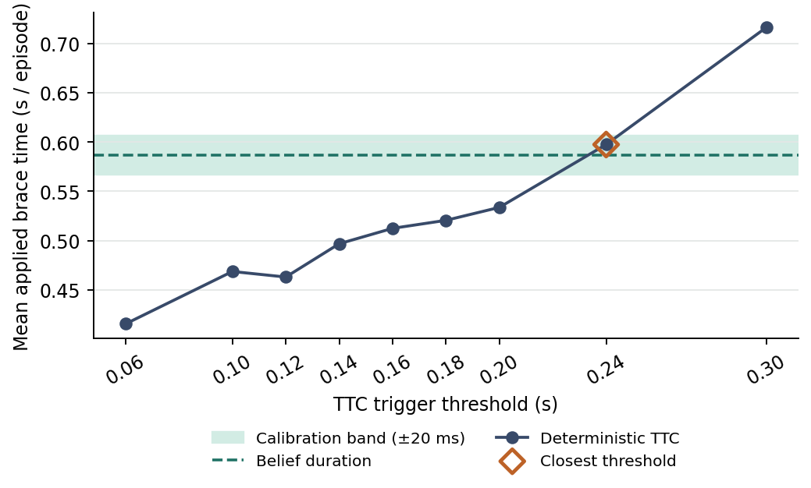

# A prospective deterministic sweep at 100 ms

This CPU pilot asks whether a single deterministic time-to-contact (TTC) threshold can use the same mean preparation time as a frozen lead-conditioned belief rule. The unit of comparison is one complete scheduled encounter, including its first terminal transition. Both controllers use the same frozen PPO skills, sensor cadence, sensor delay, commitment and release rules. Common scenario IDs refer to the same reset, planned incoming trajectory, mass, speed and detector random stream. The observation is generated by the parametric sensor model.

The protocol was frozen before inspecting these episodes. Calibration uses 32 fresh scenarios (seed 83120), nine TTC thresholds from 0.06 to 0.30 s, and the belief rule at preparation price 0.05. The selection function sees each arm's mean applied duration. It picks the closest mean and breaks ties toward the shorter threshold. It starts a fresh 32-scenario comparison (seed 83121) only if the absolute calibration gap is at most 0.020 s. The independent holdout requires the whole paired approximate 95% interval for the mean difference, TTC minus belief, to lie inside ±0.020 s. Scenario counts are small and the approximate intervals have limited resolution. [Frozen protocol](https://github.com/pchatla-arch/anticipatory-balance/blob/5a40555ca00f70cd22c2540437a4e2720dcc69d4/analysis/deterministic_cpu_pilot/protocol.json)

This lower-cost CPU run keeps all 300 control intervals per encounter. The larger registered Warp design uses separate seeds and a 512-scenario calibration and 2,048-scenario confirmation. Both use the same nine thresholds and matching criterion. A calibration failure or an imprecise holdout does not warrant a performance claim at matched preparation. Results estimate scenario variation conditional on this simulator and checkpoint pair.

## Calibration result

The 25 scheduled hits and seven scheduled near-misses were shared by each of ten arms. Across the nine TTC rules, mean applied duration ranged from 0.416 to 0.716 s. The closest rule was the deterministic 0.24 s trigger, at 0.5975 s per encounter against 0.5869 s for belief. The +10.6 ms gap passed the calibration criterion and the threshold was frozen. Selecting by the closest duration made no use of contact, failure, progress or near-miss preparation. [All 320 calibration records](calibration_episodes.csv)



## Independent confirmation

The 32 new paired encounters included 19 scheduled hits and 13 scheduled near-misses. The frozen TTC rule spent 0.560 s braced per encounter, against 0.508 s for belief. The paired difference was +52.5 ms (approximate 95% interval −86.4 to +191.4 ms). The interval extends beyond the predeclared ±20 ms equivalence band, so this pilot cannot estimate comparative protection at an established common budget. No threshold was changed after the holdout. [All 64 held-out arm records](confirmation_episodes.csv)

| Applied rule | Contacts by termination on 19 hits | Failures on hits | Failures on 13 misses | Preparations on misses | Mean forward progress, all 32 |
| --- | ---: | ---: | ---: | ---: | ---: |
| TTC, 0.24 s | 18 | 6 | 0 | 11 | 1.644 m |
| Lead-conditioned belief, 0.05 | 17 | 6 | 0 | 3 | 1.539 m |

Five scheduled-hit failures occurred on the same scenarios, one only with TTC and one only with belief. The descriptive TTC-minus-belief risk difference was 0 percentage points, with an approximate paired 95% interval of −15.0 to +15.0 points. The difference in scheduled near-miss preparation was 61.5 points (34.0 to 89.1). Neither controller made physical contact on a scheduled near-miss. Every progress value was finite. The two rules spent more time in different encounter strata: on scheduled hits, 0.656 s for TTC and 0.757 s for belief; on scheduled misses, 0.420 and 0.143 s respectively. These are descriptive subgroup means.

## Reproduction

From the prepared Foresight checkout with the project dependencies and assets, choose a fresh output directory. To regenerate the outcome table from the archived compact measurements, only Python is needed. The optional figure uses Matplotlib.

```bash
python scripts/run_foresight_cpu_threshold_pilot.py --out /tmp/foresight-threshold-pilot
python scripts/summarize_threshold_sweep.py --evidence analysis/deterministic_cpu_pilot --out /tmp/pilot-outcomes.csv
python scripts/plot_threshold_sweep.py --evidence analysis/deterministic_cpu_pilot --out /tmp/pilot-sweep.png
```

The runner verifies the [source and input manifest](input_manifest.json) against the tree at commit 3b91140. It invokes the ordinary decision-frontier evaluator with the E20 scientific flags, substituting the claimed CPU backend and pilot seeds and sample counts. It checks the full run status, pair IDs, terminal flags and duration bounds. Applied BRACE ends at the first terminal transition. The progress calculation retains the evaluator's finite progress values and reports their count. Contact is counted only when it occurs by termination. [Environment](environment.json) · [Complete outcome table](outcomes.csv) · [Frozen calibration choice](freeze.json) · [Verdict](verdict.json)

The same compiler reads complete E20 uploads directly from `results/E20_matched_.../`, using the uploaded `protocol.json`, `frozen.json`, `verdict.json`, and phase-tagged `episodes/batchNNN_conditionNNN.csv` files. Pass that run directory to `--evidence`. An operationally incomplete upload can preserve partial episode rows but cannot supply a completed comparison.

Historical duration comparisons and this pilot use different termination accounting. The project’s historical contact flag can persist after termination. In this new table, the denominator for failure among contacts is the number of contacts by termination. All other failures use the number of encounters in the indicated stratum.
