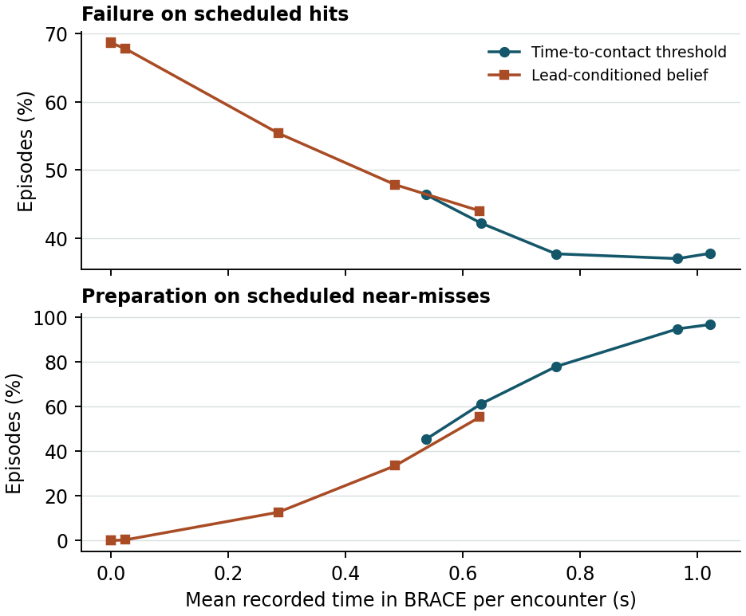

# Deterministic preparation-duration frontiers

At 100 ms of added delay, the five deterministic thresholds in the original E18 development sweep consumed 0.537–1.023 seconds of recorded preparation. The target belief rule consumed 0.484 seconds. This archived sweep provides no threshold within 20 ms of that target. In E18h only the 0.30 s threshold was saved at that latency.

There is an informative secondary comparison elsewhere on the two displayed grids. The closest pair by mean duration is the 0.30 s threshold and the belief rule with internal cost 0.02. Using all 2,048 development episodes, mean recorded duration was 0.632 versus 0.629 seconds. The table reports the threshold minus the belief rule.

| Outcome | Threshold | Belief | Paired difference (95% interval) |
| --- | ---: | ---: | ---: |
| Failure on scheduled hits | 605/1,433 | 631/1,433 | −1.81 pp [−3.35, −0.21] |
| Any preparation on scheduled near-misses | 377/615 | 340/615 | +6.02 pp [+1.46, +10.57] |
| Recorded duration over every encounter | 0.6319 s | 0.6290 s | +2.90 ms [−10.85, +16.73] |

This pair was identified after the archive was available. Its intervals condition on the chosen settings and trained skills and exclude uncertainty from searching the grid. Equal aggregate duration allows different timing and different allocations between hits and near-misses. The original brace counter can also include intervals after termination. Each point on the plot comes from an executed deterministic policy. The connecting lines show the order of the settings.

## Reproduce

From the repository root with NumPy and Matplotlib installed, run `python scripts/analyze_archived_brace_frontier.py`. The script checks the Git blob of the E18 archive, pools episode counts, and uses 10,000 paired bootstrap draws stratified by scheduled hit or near-miss. It reproduces the [full grid](operating_points.csv), [intervals](paired_comparison.json) and figure. For the fixed target belief cost 0.05, see the [prospectively frozen CPU pilot](../deterministic_cpu_pilot/) and [larger E20 protocol](../decision_tradeoff/README.md).
