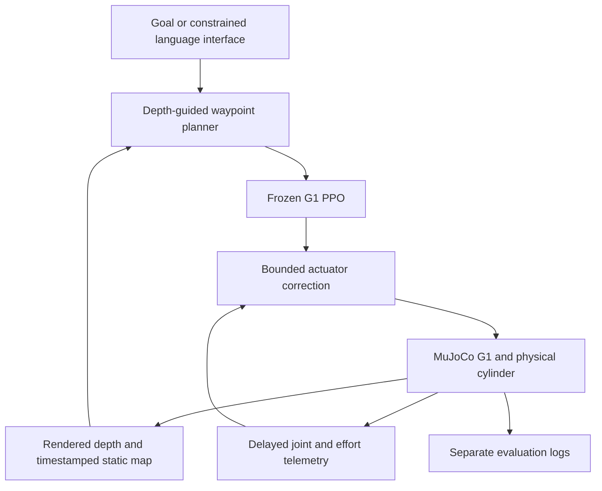

# Reliable Humanoid Navigation Under Actuator Uncertainty: Perception-Guided Planning and Adaptive Execution

## Project plan, evidence, and independent review handoff

**Author:** Prasuna Chatla · Stanford AA228/CS238  
**Updated:** November 26, 2026, Pacific (November 27 UTC in run filenames)  
**Project:** [PR #51][pr] · code branch `oaa/g1-obstacle-demo-prototype-20261126` · evidence branch `foresight/experiment-results`  
**Baseline examined for this handoff:** [79a82e6][source-snapshot]. Each experiment below has its own immutable code and result revision.

**Start here.** The title above is the agreed title. The intended deliverable is a coherent, reproducible project connecting perception-guided navigation, a frozen humanoid locomotion policy, and adaptive execution under actuator uncertainty. The current evidence includes completed actuator experiments, a failed navigation pilot, a successful healthy navigation rollout, and one faulted navigation comparison. The original 72-episode navigation study, a convincing multi-seed reliability result, and the final submission package are unfinished.

This document consolidates the agreed direction, actual observations, corrections to earlier interpretations, and the work required to finish. It supersedes earlier *current-status* summaries and the former restriction of Claude to review only. Historical protocols and failed attempts remain available. Claude is invited to independently challenge the analysis and recommendations, improve the implementation, and help lead execution and result updates within the project's established scope and budget. No work has been assigned to or accepted by Claude through this document.

## 1. What was agreed and what completion means

The central research question is:

> Can a frozen humanoid walking policy preserve useful navigation and commanded motion under hidden actuator-gain changes, using causal telemetry and bounded online correction, while avoiding harmful intervention in healthy operation?

The system extension adds head-camera depth, a physical simulated obstacle, goal-directed planning, and a constrained language-goal interface. The [navigation decision][depth-adr] and [language/hierarchy decision][language-adr] record the evolution of that scope. “Reliable” states the research objective; the existing small development sample does not establish broad reliability.

| Expected output | Completion criterion | Current state |
| --- | --- | --- |
| One consistent project and title | Plan, report, experiment ledger, and presentation describe the same system and evidence | Title restored; this handoff reconciles current status |
| Working perception-to-action system | Actual simulator depth influences planning; frozen G1 actor and causal adapter run together | Demonstrated in one G3 seed, with explicit limitations below |
| Comparative experiments | Frozen protocol, appropriate controls, complete outcome accounting, raw traces, and descriptive or statistical analysis appropriate to the sample | S1a complete; G3 one pair; original 72-row matrix unexecuted |
| Honest results and failures | Every claim maps to saved data; stopping failures, nuisance sensing, and unsuccessful attempts remain visible | Major evidence exists; interpretation and instrumentation gaps identified |
| Reviewable code and reproduction | Immutable source/config/checkpoint references, exact commands, environment, data, and executable audits | Partial; command/manifests and full G3 telemetry need improvement |
| Demonstration video | Actual simulator footage, source/run labels, healthy and faulted comparisons, failures disclosed | Individual G2b/G2c/G3 clips exist; final comparison edit/captions pending |
| Course report and final PDF | Correct equations, results, limitations, references, rendered figures, reproducibility, author-verified AI disclosure | Markdown draft exists; final PDF and submission review pending |
| Predictable execution and updates | One execution owner, bounded runs, live status artifacts, result publication, verified compute shutdown | Prior runs were published; durable monitoring and budget reconciliation remain open |

The course documents record a **November 27 working deliverable** and **December 4 submission target**. These are project planning dates from the existing records, not a fresh verification of the course syllabus. The author should verify submission format and AI-use policy before release.

The original [72-row registration][registration] remains an unmet plan: **2 layouts × 2 gain schedules × 3 methods × 6 paired scenario seeds**, at most 1,200 control ticks each. The methods include a velocity-informed candidate that has not been validated in the integrated navigation system. A smaller study can be proposed as a documented scope change; it must not be described as completion of that registration.

## 2. Architecture and information boundaries



The measured navigator uses simulated localization and calibrated camera extrinsics. Obstacle estimates come from rendered metric depth, with static-map memory after the cylinder leaves view. Simulator localization is privileged information and must be disclosed. The planner must not receive the true obstacle position; the practical adapter must not receive true gain, onset, restoration, or oracle labels. Those quantities belong in separate evaluation logs.

The nominal actor is frozen at `checkpoints/nominal_s1/000202342400`; the registered checkpoint tree SHA-256 is `14bd6650f06c4e3171b6e2d2403ef0da5d9dd3604709f0c22b488329dd0223de`. The heuristic configuration was frozen at `d756c37d0564837a74132c30f8e366320a6bb1a5`. The registered integration targets are 50 Hz control and 10 Hz depth. Simulated time and GPU throughput do not establish real-time deadline compliance.

Scope is flat-terrain simulation with a single stationary cylinder. The implemented language parser/schema has CPU/interface tests and is deterministic, not a trained VLM or VLA. The reported G3 rollouts do not demonstrate end-to-end language grounding. Actual learned language/image grounding, learned robot actions, moving obstacles, physical G1 hardware, and general safety are unmeasured. The velocity-informed candidate and sensor-confound abstention ideas remain separate research tasks.

The earlier Foresight work and protected WP2.2 attempt on PR #46 are separate records. Do not pool their episodes into this study or replay a protected attempt to make an incomplete result look complete.

## 3. Experiment inventory

Counts describe distinct recorded experiments, not every folder or copied publication.

| Stage | Evidence and outcome | Interpretation |
| --- | --- | --- |
| Earlier CPU baseline | [256 episode rows][cpu-results] using an earlier heuristic/configuration | Historical development result; not the G3 method, not 256 navigation trials |
| Earlier heuristic tuning | Historical documents report 17 evaluations; the inspected frozen [tuning log][tuning-log] contains 4 completed entries | Provenance/count reconciliation open; do not assert 17 independently verified runs |
| S0 CUDA smoke | [12 rows, 160 ticks][s0] | Frozen actor/evaluator smoke completed; no rerun needed for this handoff |
| S1a actuator screen | [32 rows, 400 ticks][s1a]: 4 families × 4 methods × 2 paired scenarios | Complete small development screen; scenario IDs are not independent training runs |
| S1b analysis | Existing CSV analysis plus [new raw-trace segment audit](review_audits/2026-11-26/s1a_segment_audit.json) | CPU reanalysis only; corrects the interpretation of forward distance |
| G2a contact gate | [Real G1 model/contact test][g2a]: 0 initial contacts; 4 explicit pairs activated by evaluator-only forced overlap | Confirms configured contact plumbing, not all-body collision coverage |
| G2b initial navigation | [800 ticks][g2b], 160 frames; stopped after observation loss, failed to reach goal | Genuine negative result retained |
| G2c static-map navigation | [1 healthy rollout][g2c], 1,186 executed ticks, goal reached, 0 recorded cylinder-contact ticks | One development success after revising the memory rule |
| G3 causal smoke | [300-tick smoke][g3-smoke], 291 released packets, 184 corrective ticks | Adapter integration check; not a comparative navigation result |
| G3 paired navigation | [2 arms, same seed 1][g3]; both reached goal under gain fault/recovery | Integration feasibility, not demonstrated general superiority |
| Original navigation matrix | [72 rows registered][registration] | Unexecuted; cannot be counted as delivered |
| Other interrupted/protected work | Earlier partial standalone actuator and WP2.2 records | Separate attempts; unresolved status must be reported separately, not silently merged |

G2c's timestamped folder and `g1_g2c_static_memory_20261127` are aliases of the **same** trajectory. Their `frames.jsonl` Git blob is `c3827e7cf3507e6cc5232d434c01d8fbe65e4d97`. The two G2b publication locations likewise do not create a second independent trial.

## 4. Actuator results and the corrected interpretation

S1a used a fixed walk–turn–stop–resume phase sequence; commanded speeds can differ between scenario IDs and families. Methods are paired within each family/scenario, not across healthy and fault families. The practical methods received delayed/noisy effort telemetry; the oracle received true gain. Each table cell is the mean of two paired scenarios.

| Condition | No correction loss | Heuristic loss | Oracle loss | Main observation |
| --- | ---: | ---: | ---: | --- |
| Gain 0.70 | 0.085517 | 0.038328 | 0.028719 | Heuristic loss 55.2% lower in this development sample |
| Gain 0.70 then restoration | 0.061005 | 0.036317 | 0.030879 | Heuristic withdrew in 2/2 cases, after 5 and 6 ticks |
| Healthy | 0.022096 | 0.022658 | 0.021619 | Heuristic nearly inactive; small differences are descriptive |
| Healthy actuator, effort scale 0.8 | 0.026801 | 0.031044 | 0.026801 | Heuristic worsened loss by about 15.8%; nuisance sensing remains unsolved |

The registered loss is capped squared planar velocity error, not goal success and not yaw tracking. No falls were recorded in the 32 episodes. That small sample does not establish a rare-failure rate or physical safety.

**Correction to earlier reporting.** Under gain 0.70, recorded forward distance was 3.621946 m for correction-off and 2.440928 m for the heuristic. Earlier summaries interpreted the reduction as a locomotion penalty. That conclusion was not supported. The benchmark's `progress_m` sums displacement projected on the previous torso heading over the observed exposure window; it rewards movement even during a commanded stop.

Raw NPZ traces confirm the stop problem. During ticks 200–274, commanded forward velocity is zero:

| Gain-0.70 scenario | None mean forward velocity | Heuristic mean forward velocity | Oracle mean forward velocity |
| --- | ---: | ---: | ---: |
| Scenario 0 | 0.329 m/s | 0.054 m/s | 0.073 m/s |
| Scenario 1 | 0.349 m/s | 0.274 m/s | 0.122 m/s |

Thus some extra uncorrected distance is unwanted continued motion. The heuristic improves stopping much more in the first scenario than in the second; its performance is inconsistent. Shorter distance alone proves neither a penalty nor better navigation. The [reproduction script](../../scripts/reanalyze_s1a_segments.py) and [audit JSON](review_audits/2026-11-26/s1a_segment_audit.json) record phase definitions, source blobs, and loss checks. The new NPZ audit covers eight episodes across four cells: healthy/none and gain-0.70/{none, oracle, heuristic}. Their saved per-tick losses reproduce CSV values within approximately 7.5×10⁻⁹; the separate CSV inventory covers all 32 rows. No new physics was run.

The return experiment establishes a limited withdrawal observation: heuristic 2/2, median 5.5 ticks (110 ms), versus estimated inverse 0/2. It does not supply missing G3 withdrawal traces. Under sensor scaling, mean unnecessary heuristic offset is 0.043697 rad; the inverse reaches 0.107939 rad. Effort-only adaptation cannot assume that sensor-scale error and physical gain loss are distinguishable. A proposed abstention method needs new evidence before it can be claimed as a solution.

## 5. Navigation results and their limits

The G2b pilot detected the cylinder from real 96×96 depth but lost usable obstacle observations during the turn. It conservatively stopped at tick 515 and finished near (2.11, 1.57) m rather than the (5, 0) m target. Static-map persistence was then developed and tested in G2c. This is development on observed failure, not an untouched evaluation.

G3 used source `7ea45d1522e3d70ee950b98eb4aee1fe35013fd5`, seed 1, and gain 0.70 during ticks 200–899, restored at tick 900.

| Quantity | G2c healthy reference | G3 fault / correction off | G3 fault / heuristic |
| --- | ---: | ---: | ---: |
| Goal reached | Yes | Yes | Yes |
| Executed control ticks | 1,186 | 1,159 | 1,111 |
| Final tick index, zero-based | 1,185 | 1,158 | 1,110 |
| Final goal distance | 0.185812 m | 0.194519 m | 0.191739 m |
| Recorded cylinder-contact ticks | 0 | 0 | 0 |
| Saved RGB/video frames | 238 | 232 | 223 |
| Nonzero correction ticks | Not applicable | 0 | 703 |

These are [saved status/audit values][g3-audit]. Published video audits identify actual H.264 simulator footage. The 48-tick difference is 0.96 simulated seconds; it is descriptive, with one seed, and both faulted arms succeeded. End distances reflect crossing an approximately 0.2 m goal threshold and are not a meaningful precision ranking. The healthy reference uses a different source revision, so it is contextual rather than a fully controlled third arm.

The physical scene explicitly pairs the cylinder with torso, pelvis, and two thighs. Zero recorded contacts does not establish full-body swept-volume clearance. G3 already checks a combined termination/fall condition after each simulator step; both runs ended with `goal_reached`. The next evaluation should validate that detector, record per-tick fall flags, and distinguish falls from other termination causes. The present artifacts provide no separate fall count. Detection-frame counts are not recall, since the object leaves the camera view and the planner retains static memory.

**Pairing and telemetry gaps.** At the tick-200 pre-step sample, correction-off and heuristic positions already differ by 2.40 cm. Same seed does not mean identical replay. Their closed-loop commands can also diverge as their poses diverge. Full control-tick body-frame velocities, gain estimates, requested/effective offsets, and withdrawal events were not retained in G3. The final across-leg estimate of 0.937 is a final snapshot after restoration, not an episode-mean gain estimate.

A [new CPU trajectory audit](review_audits/2026-11-26/g3_sampled_audit.json) uses saved samples from ticks 200 through 900. Path length is 5.208855 m for correction-off and 4.669332 m for the heuristic. A heading-projected, stride-5 forward-error proxy is 0.105061 versus 0.083423 m/s. These are **post-hoc diagnostics**, not registered high-rate tracking metrics or evidence of statistical superiority. Planar speed divided by forward command is not a valid substitute for body-frame tracking error.

## 6. Existing Claude review and unresolved issues

Claude has already supplied a substantive [review of the paired G3 results][claude-review]. The handoff acknowledges that work rather than requesting a duplicate first review.

| Review issue | Current resolution or remaining task |
| --- | --- |
| Extra distance may be overspeed, especially during stop | Confirmed directly from S1a NPZ traces; earlier “progress cost” interpretation corrected |
| Both G3 arms reach the goal | Confirmed; the 0.96 s difference is not presented as proven benefit |
| Same-seed trajectories diverge before fault | Confirmed at approximately 2.40 cm; quantify replay variability in future evaluation |
| Per-tick gain/offset traces missing | Confirmed; add instrumentation before another comparative batch |
| G3 command-following may improve | Sampled diagnostic is consistent with this; high-rate measurement and more seeds required |
| Final mean gain estimate suggests persistent error | Correction: 0.937 is a final across-leg snapshot after recovery; temporal miscalibration cannot be inferred |
| Approximate trajectory numbers in review | Path lengths reproduce; exact sampled speed ratios/max-y differ. Use executable audit definitions, not rounded reviewer claims |
| Registration/provenance gaps | Preserve original protocols; reconstruct missing manifest fields as retrospective, never backdate registration |
| Some summaries still said completed navigation was pending | README, tracker, brief, report, and PR description are reconciled with this handoff |
| Original 72-row plan and final report unfinished | Kept explicit; no invented completion or silent substitution |

Reviewer independence includes questioning the novelty, evaluation design, and whether the evidence supports the title's language. The title remains as agreed unless Prasuna changes it; reviewing its claims is encouraged.

## 7. Work plan for completion

Roles below are **proposed coordination**, not claims that another assistant has accepted a task. Prasuna owns scope, spending limits, and final submission. Claude is welcome to take execution leadership; ChatGPT can support implementation, audits, documentation, and updates. Select one execution owner before any shared pod work.

| Work package | Concrete work and deliverable | Acceptance criterion | Dependency |
| --- | --- | --- | --- |
| WP1: Evidence and narrative | Reproduce S1a segments and G3 sampled diagnostics; plot commands, measured motion, stop and return behavior; close reviewer issues | Every plotted value traces to immutable raw data; claims and count discrepancies explicitly resolved | Existing data; CPU only |
| WP2: Measurement repair | Add per-tick command/velocity, gain vector, requested/effective offset, packet source/release tick, age, contacts, fall state, termination reason | An automated audit reconstructs onset, adaptation, recovery and withdrawal; evaluator labels never enter controller inputs | Source review and focused causal tests |
| WP3: Freeze next protocol | Choose matrix, seed list, primary metric, controls, fault windows, failure handling, code/config/checkpoint hashes, run IDs | Protocol committed before physics; scope change from original 72-row plan explicit | WP1–2 |
| WP4: Execution readiness | Reconcile spending; validate one-pod ownership, authentication/publication, checkpoint, watchdog, sufficient shutdown reserve | Remote publication smoke and provider-independent stop mechanism verified; run fits actual remaining authority | WP3 and budget evidence |
| WP5: Bounded experiments | Run instrumented smoke then approved matrix; publish successes, failures, logs and actual costs | Every intended arm has complete evidence or an explicit failure reason; compute stop receipt saved | WP4; smoke passes |
| WP6: Independent result audit | Recompute episode metrics, compare paired seeds, inspect worst cases and intervention harms, verify provenance/video mapping | Separate raw-data-to-table/figure check; uncertainty matches sample; no selective omission | WP5, or current-data fallback |
| WP7: Report and demonstration | Correct manuscript, references and disclosure; generate final tables/figures/PDF; edit labeled simulator comparison with failure context | PDF visually checked, links reproduce evidence, author reviews submission and claims | WP1/6 |

For the November 27 working deliverable, prioritize WP1, the reconciled plan/report, and honest existing clips. A new batch is conditional on readiness and verified budget; its failure to fit must be recorded promptly. Before the December 4 target, complete the audit, final PDF/video, and author checks. No unmeasured experiment should block the explanation of already measured findings.

A fallback must be described plainly: submit the completed actuator development study and limited navigation demonstration, explain the 72-row shortfall and missing reliability evidence, and retain negative results. That is a documented reduction in scope, not retrospective fulfillment of the original plan.

## 8. Proposed next experiment: decision-ready, not already approved

Claude proposed **five scenario seeds × three arms = 15 episodes**:

1. Healthy actuator, correction off.
2. Hidden gain 0.70 with restoration, correction off.
3. The identical fault schedule, frozen heuristic.

All arms should use the same frozen instrumented code, checkpoint, scene, sensor model, planner and goal, capped at 1,200 ticks. Fix the seed list and run order before execution. This proposal tests a focused portion of the original matrix; it omits the clear-layout and candidate-method comparisons and cannot replace their evidence by implication.

**Primary measurement proposal:** control-tick body-frame forward velocity tracking error over the fixed fault interval, with formula, cap, units and window specified in the protocol. Include yaw/planar error separately if useful; do not conflate them with the S1a loss.

**Required companion outcomes:** goal/timeout/fall/contact outcomes, phase-specific stopping and post-recovery errors, path length, command magnitude, false healthy intervention, correction amplitude/slew, estimator trace, withdrawal success and latency, packet age/loss, and wall runtime. Use common windows and a declared treatment of early termination so that a failed run cannot appear better merely because it ended sooner.

A healthy-plus-heuristic arm is valuable for testing false intervention in this same navigation setting; adding it makes four arms and changes the cost. Repeat/no-op controls can quantify nondeterminism. Both are explicit design decisions, not silently added runs. Use all seeds, display individual paired differences, and treat five-seed uncertainty as limited.

Any change to the estimator, gate, memory rule, metrics, or thresholds after viewing results creates a new disclosed development revision. A learned adapter or velocity-informed candidate needs its own validation and registration.

## 9. Pod execution, spending, and progress reporting

The existing [registration][registration] records a cumulative **$4.44 GPU-compute cap**, at most six GPU-hours, one pod, and a 30-minute publication/shutdown reserve. Later execution notes identify a preferred Secure RTX A6000 at **at most $0.69/hour**; earlier registrations name a Community RTX 6000 Ada at at most $0.74/hour. These are recorded terms, not current stock or pricing claims. Reconcile any hardware/rate substitution with the latest user authorization before launch.

The old tracker quoted approximately $2.31 of posted charges, with billing lag and a wider date range. That figure is **not a verified current demo balance**. Link each charged session to this scope, include unposted accrued runtime and storage separately, and save provider stop receipts. No live all-pods or current-balance check was performed solely to publish this handoff.

At an assumed five minutes per episode, 15 × 5 / 60 × $0.69 = **$0.8625 of episode runtime**. Boot, installation, compilation, failed attempts, uploads, storage and the stop reserve are additional. This arithmetic is not a quote, an actual runtime forecast, or new spending authority.

A pod-local timeout only ends a process; an hourly availability check does not enforce a hard spending cutoff. A provider-independent stop/watchdog arrangement has not been established by this handoff. Before a billable run, the execution owner must establish an effective stop path, test publication, verify no conflicting active project pod, and reserve enough time to publish and stop.

For every run, publish a small status record with run ID, owner, source/config hashes, provider ID, stage, completed/expected arms, timestamps, last error, evidence link, accrued-cost estimate and next action. Update on stage transitions, failures, publication and confirmed shutdown; keep a heartbeat during long computation through an actual running mechanism. A plan must not imply background execution that has not started.

Existing launcher/evaluator entry points are listed below for code review, not as an unchecked one-click launch recipe. Validate their flags, credential handling, output schema and shutdown behavior before use. Secrets belong in the execution environment, never in the repository.

## 10. Reproduction and source map

Use separate source and results checkouts. This avoids accidentally changing scientific source while reading the results branch.

```bash
git clone --branch oaa/g1-obstacle-demo-prototype-20261126 \
  https://github.com/pchatla-arch/anticipatory-balance.git anticipatory-balance-source
git clone --branch foresight/experiment-results \
  https://github.com/pchatla-arch/anticipatory-balance.git anticipatory-balance-results
```

For exact historical replay, select the immutable source and result commits in the evidence index, not the latest moving branch. Checkout alone does not provision the checkpoint, simulator assets or dependencies. The S1a reanalysis script requires a downloaded `bench_dev` directory and NumPy. The standard-library G3 script can download its pinned inputs or read an offline directory. Neither trains a model nor launches a simulator or pod.

| Component | Entry point |
| --- | --- |
| Actuator evaluator | [eval_adaptive_bench.py](../../scripts/eval_adaptive_bench.py) |
| G2 nominal navigation | [eval_g1_obstacle_nominal.py](../../scripts/eval_g1_obstacle_nominal.py) |
| G3 causal navigation | [eval_g3_depth_actuator.py](../../scripts/eval_g3_depth_actuator.py) |
| Causal controller | [single_causal_controller.py](../../foresight/adaptive/single_causal_controller.py) |
| Depth / route / contact setup | [obstacle_depth.py](../../foresight/adaptive/obstacle_depth.py), [obstacle_route.py](../../foresight/adaptive/obstacle_route.py), [obstacle_scene_xml.py](../../foresight/adaptive/obstacle_scene_xml.py) |
| Existing pair auditor | [audit_g3_paired_navigation.py](../../scripts/audit_g3_paired_navigation.py) |
| New CPU reanalysis | [S1a script](../../scripts/reanalyze_s1a_segments.py), [G3 sampled script](../../scripts/reanalyze_g3_samples.py) |
| Pod execution tools to review | [g1_detached_run.py](../../scripts/g1_detached_run.py), [run_g1_pod_one_command.py](../../scripts/run_g1_pod_one_command.py), [g1_demo_preflight.sh](../../scripts/g1_demo_preflight.sh) |
| Manuscript / experiment index | [Course report](Course_Report_20261127_Draft.md), [tracker](EXPERIMENT_TRACKER.md) |

### Immutable evidence index

| Evidence | Code / record reference | Published result reference |
| --- | --- | --- |
| Earlier CPU baseline | Source snapshot `89b6d0d`; its config records `a45b10c` | [256-row CPU directory][cpu-results] |
| S0 | `43ca493bb5e7ca5e7397b1059a1eb922514cca50` | [9a9ed5e / 12-row run][s0] |
| S1a | `89b6d0dd31020f00032330c76684c727b1f697a0` | [896000b / CSV and NPZ traces][s1a] |
| G2a | `15bfd72603d5dac6cecaf2d3cc192d0d10904291` | [a028421 / contact result][g2a] |
| G2b | `1fd2d776cd06b270c1b099c6ce8d474d55ec4931` | [eff258a / negative route and video][g2b] |
| G2c | `6d75add0f2b6ceb601f90a5376818edcce10cfee` | [b902531 / healthy route][g2c] |
| G3 smoke | `7ea45d1522e3d70ee950b98eb4aee1fe35013fd5` | [700ef3c / causal smoke][g3-smoke] |
| G3 pair | Same `7ea45d1` | [55dfa2d / both arms and audit][g3] |

Result revisions and raw fields take precedence over a prose status label. Original registrations remain unchanged as dated records; completion or deviations are recorded separately.

## 11. Request to Claude

Please independently assess whether the agreed project can be completed credibly from this state. Review the raw evidence and existing comments first; challenge the scientific framing, methods, metrics and priorities where warranted. Provide a ranked list of blocking issues, corrected recommendations, and a concrete completion plan. You are welcome to help implement corrections, run CPU audits, improve instrumentation, take ownership of appropriately authorized pod experiments, and keep the result ledger and report current.

Start with the S1a stop-phase finding, the G3 telemetry/paired-control gaps, the unresolved sensor confound, and the discrepancy between the original 72-row plan and delivered evidence. Separate what can be finished using current data from what requires new measurements or a scope decision. Report failed experiments and budget/runtime facts as carefully as successes. Do not assume the existing narrative or a prior assistant's conclusion is correct.

The project is complete when the chosen scope is explicit, evidence and claims agree, experiments are accounted for, compute is stopped, and Prasuna has a reviewed final report and authentic demonstration—not merely when another plan has been written.

[pr]: https://github.com/pchatla-arch/anticipatory-balance/pull/51
[source-snapshot]: https://github.com/pchatla-arch/anticipatory-balance/tree/79a82e65b3d3ac2e925301686cb9c3ec6a07e306
[depth-adr]: ADR_obstacle_detection_avoidance.md
[language-adr]: ADR_language_conditioned_hierarchy.md
[registration]: ../../results/g1_gpu_demo_registration_20261126/registered_experiment_queue.json
[cpu-results]: https://github.com/pchatla-arch/anticipatory-balance/tree/89b6d0dd31020f00032330c76684c727b1f697a0/results/bench_dev_cpu_v0
[tuning-log]: https://github.com/pchatla-arch/anticipatory-balance/blob/89b6d0dd31020f00032330c76684c727b1f697a0/results/tune_heuristic_dev_cpu_v0/tuning_log.json
[s0]: https://github.com/pchatla-arch/anticipatory-balance/tree/9a9ed5ea3b3626d709c05d622f0e7e20ec85f876/results/g1_course_dev_20261127T024308Z_104a34
[s1a]: https://github.com/pchatla-arch/anticipatory-balance/tree/896000b68aa9c7ea6efcd33ea33b4973ed629bb0/results/g1_course_dev_20261127T032240Z_5fc7dd
[g2a]: https://github.com/pchatla-arch/anticipatory-balance/blob/a02842102a901c0643eeb27c224223ade0fff086/results/g1_g2a_model_contact_20261127/physical_contact.json
[g2b]: https://github.com/pchatla-arch/anticipatory-balance/tree/eff258a3e11129fbf31a64388229acd5ac8becb2/results/g1_g2b_nominal_20261127
[g2c]: https://github.com/pchatla-arch/anticipatory-balance/tree/b90253190c36024e3daef9bcf4c25c8d84dc781f/results/g1_g2c_nominal_20261127T045324Z_6d75add
[g3-smoke]: https://github.com/pchatla-arch/anticipatory-balance/tree/700ef3c079cb04704ba65591fe5e067d25defab7/results/g3_causal_smoke_20261127_seed1_7ea45d1
[g3]: https://github.com/pchatla-arch/anticipatory-balance/tree/55dfa2d2a15790f1caa13b9460faf268081225ab/results/g3_paired_fault_20261127_seed1_7ea45d1
[g3-audit]: https://github.com/pchatla-arch/anticipatory-balance/blob/55dfa2d2a15790f1caa13b9460faf268081225ab/results/g3_paired_fault_20261127_seed1_7ea45d1/paired_independent_audit.json
[claude-review]: https://github.com/pchatla-arch/anticipatory-balance/pull/51#issuecomment-7210669939
