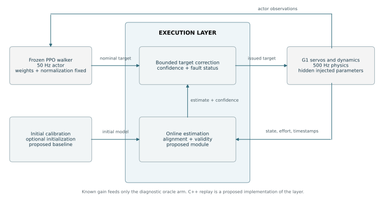
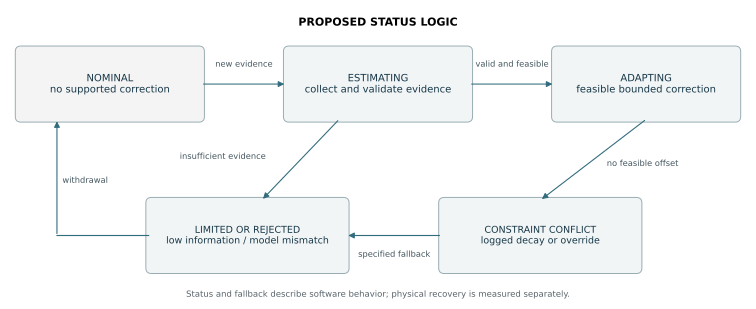

# Fleet Robust Execution

## An actuator aware execution layer for learned humanoid locomotion

**Prasuna Chatla | pchatla@stanford.edu**

**Technical design and experimental protocol | Review draft 0.2 | November 15, 2026**

**Reading guide.** This document develops the four-page Fleet-Robust Execution specification into a research and implementation plan. The system boundary is fixed: an existing G1 PPO walker, optional initial calibration, online actuator estimation, bounded target correction, confidence and fault supervision, and a C++ implementation. The paper defines the physics, permitted information, learning comparisons, evaluation, runtime, and review criteria within that boundary. The immediate deliverable is a working execution component with traceable evidence. Research claims are earned by the specified comparisons.

**Evidence at this revision.** The known-gain simulation wrapper, bounded privileged correction, and paired feasibility protocol are implemented and locally checked on CPU. GPU recovery, practical identification, calibration, confidence logic, learned adapters, the C++ runtime, and the work-cycle demonstration are not yet measured results. The implementation baseline is aac0699; the reviewed roadmap baseline is 16c3296. This is a design paper with an experimental protocol, not a report of completed adaptation experiments. [13]

## Abstract

Learned humanoid policies issue motion commands through actuator and sensing interfaces whose behavior can differ across robot instances and over time. This project develops an execution layer that preserves a frozen locomotion policy while estimating a declared actuator-response model and applying bounded corrections to its joint-position targets. The first model is proportional-servo gain variation with unchanged damping and force limits. A causal measurement interface connects issued commands, joint state, effort telemetry and timestamps. A classical estimator supplies gain estimates and model-validity diagnostics; confidence and available command authority limit the correction. An analytical snapshot result defines when a correction cannot increase modeled instantaneous actuator-force error, under explicit assumptions. It does not establish humanoid stability. Deep RL enters through the frozen PPO walker, a learned-history estimation comparison, an actuator-randomized PPO baseline, and an optional residual policy targeted at a measured classical limitation. The evaluation separates compensation feasibility, identification, erroneous intervention, task performance and runtime. A simulated fleet is defined by held-out heterogeneous actuator instances, rather than by large batches of identical robots. The planned demonstration is a walk-turn-stop-resume cycle, accompanied by source and checkpoint provenance, paired evaluation, failure analysis, C++ replay parity, and measured timing. All new recovery and generalization claims remain conditional on these experiments.

## Problem and objectives

A policy trained against a nominal robot may receive different physical responses from the same outgoing command when actuator characteristics differ. The resulting control problem is to retain useful motion while estimating what changed, correcting only what the available interface can influence, and reporting uncertainty or insufficient authority. Actuator response and torque capacity are separate properties. A smaller proportional gain may be compensated through a larger target error; a motor already at its force ceiling cannot produce arbitrary additional torque.

Fleet deployment motivates reuse of one policy and one documented execution interface across robot instances. In this project, fleet initially means a controlled population of simulated G1 instances with different actuator parameters. It does not mean operation of physical robots or a measured manufacturing distribution. The existing walker was not trained with explicit gain and delay randomization. That establishes an evaluation gap, not proof that it cannot tolerate those changes. A single policy trained with actuator randomization could cover many instances; this is an explicit comparison.

The primary objective is to preserve task performance under identifiable, compensable response changes while measuring healthy-operation regression, recovery delay, intervention size and runtime. The secondary objective is to characterize the circumstances in which the chosen interface should limit correction or declare its model unsupported. Useful behavior means completing commanded locomotion phases, rather than remaining upright at any cost or reporting training reward alone.

### Fixed design decisions

The base platform is the simulated Unitree G1 in MuJoCo Playground. The initial actor, its normalization, observation order and previous-action convention remain unchanged for all adapter comparisons. The actuator interface accepts position targets. Online estimation and bounded correction remain separate modules with explicit inputs and outputs. A confidence and fault supervisor controls corrective authority and exposes status to the caller. Calibration initializes the same parameter representation; it is an optional baseline and bring-up mode, not a hidden source of fault labels. A C++ port implements the estimator and corrector behind the same semantic interface.

The first closed-loop configuration retains the existing 50 Hz policy/correction rate and 500 Hz physics. A 1 ms C++ compute target is a later measured implementation objective. Faster physical correction requires a separate timing configuration and its own evaluation. The core project has an independent portfolio timeline. An unsuccessful experiment triggers diagnosis of the fault regime, measurement model, timing or authority assumptions; it does not automatically change the project theme.

### Research hypotheses

- **H1 Compensation.** A moderate proportional-gain change degrades the frozen walker, and a bounded true-gain correction recovers a meaningful part of that degradation on fresh scenarios.
- **H2 Identification.** The declared telemetry supports useful estimation during ordinary task execution, with observable limits under weak excitation, sensor error and contact or loading changes.
- **H3 Confidence.** Identification validity and command authority improve the recovery versus erroneous-intervention tradeoff relative to an otherwise identical estimated inverse.
- **H4 Learning.** A learned history estimator, and only where justified a learned residual, improves a named limitation under matched information and correction limits.
- **H5 Reuse.** The execution layer retains useful behavior across held-out simulated instances, independent frozen policies and command transitions, at a measured training and runtime cost.

These hypotheses specify experiments. None is claimed established in this draft. The intended research contribution is the demonstrated behavior of a well-specified execution mechanism and its limits under realistic declared information, not the first use of adaptation around an RL policy.

## System architecture and component ownership



The actor owns nominal behavior. The execution layer owns command realization, estimation state, measurement alignment, correction constraints and diagnostic status. The simulator owns the robot dynamics and injected disturbances. Hidden simulator parameters are logged by the evaluator and are unavailable to practical inference. The true-gain controller is a diagnostic arm with an explicit information advantage.

| Component | Runtime behavior | Implementation state |
|---|---|---|
| Frozen PPO actor and normalization | Nominal joint targets; weights unchanged | Restored and used by current gate |
| Gain-fault plant and known-gain corrector | Controlled response change and privileged correction | Implemented; CPU checks recorded |
| Initial calibration | Fits initial model and saves its validity metadata | Proposed baseline |
| Classical online estimator | Updates gain state from permitted historical measurements | Proposed |
| Confidence and fault supervisor | Limits correction; reports model and constraint status | Proposed |
| Learned history estimator | Fixed trained network; changing history and hidden state | Proposed comparison |
| Residual PPO | Optional fixed trained correction policy at deployment | Conditional experiment |
| Actuator-randomized PPO | Separately trained complete policy | Proposed robustness baseline |
| C++ estimator and corrector | Same numerical contract, bounded memory, timing traces | Proposed |
| Commanded work cycle | Walk, turn, stop and resume | Proposed; healthy competence first |

### Interface contract

Each control request contains a sequence number, control timestamp, nominal target vector, active limits, and the frozen-policy identifier. Each telemetry packet contains source and arrival timestamps, measurement-channel identifiers, encoder state, declared effort data, and an issued-target identifier. IMU-derived orientation and angular velocity support the nominal actor and task-health diagnostics; they do not magically resolve actuator gain. Contact information is either explicitly sensed/estimated from permitted channels or confined to a labeled diagnostic.

The layer returns the issued target, requested and effective correction, gain estimate, confidence diagnostics, and a reason code. Suggested reason codes are NOMINAL, ADAPTING, LOW_EXCITATION, STALE_MEASUREMENT, MODEL_MISMATCH, INSUFFICIENT_AUTHORITY, CONSTRAINT_CONFLICT and INVALID_INPUT. These are proposed interface categories, not proof that every degraded physical state is safely handled.

The evaluator records physical termination, numerical invalidity and task completion separately. A status flag is useful only if its definition and downstream response are specified. Returning an uncorrected command can preserve software continuity while leaving the robot physically degraded.

### What changes and what remains frozen

During deployment, the classical estimator's parameter state and uncertainty proxy change; the policy weights and observation normalization do not. A learned history estimator may adapt its output and recurrent state while its weights remain fixed. The same is true for a trained residual policy. Online inference from new history is distinct from online gradient training. The actuator-randomized PPO baseline changes the full policy during training and then freezes that different actor for evaluation.

This separation allows each experiment to answer a specific question. A change to the frozen actor's observation ordering, normalizer, command scaling or action history changes the controller even if the weight file is unchanged. Those quantities are included in the reproducibility manifest.

## Simulated fleet and disturbance model

A simulated robot instance receives an instance identifier and a persistent parameter vector sampled before its episodes. The vector may contain per-joint or per-group gains, while an episode-specific schedule describes subsequent drift or abrupt changes. All episodes belonging to one instance remain in the same training, validation or test split. Holding out only episode seeds while reusing the same calibrated instance across splits is insufficient for an unseen-instance claim.

The first experiment uses the implemented common leg-gain changes. Subsequent tests introduce heterogeneous joints and correlated joint groups, with the sampling distribution declared as a simulation assumption. These distributions are not presented as measured G1 manufacturing tolerances. Calibration budgets and online data availability are recorded per instance, so a method cannot receive unlimited instance-specific data without that cost appearing in the comparison.

| Variation | Physical or observational meaning | Role in the study |
|---|---|---|
| Proportional gain | Target error produces a different actuator force | First compensable model and current gate |
| Response lag | An internal response state follows commands gradually | Later separately identified model |
| Transport delay | An older command reaches the actuator | Separate causal history/prediction test |
| Torque ceiling | Maximum force authority decreases | Capacity-limit control, not inverse recovery promise |
| Joint/contact friction or payload | Mechanical dynamics change outside gain model | Nuisance and model-rejection tests |
| Encoder/effort bias, noise or delay | The measurement model changes | Estimator robustness and false-intervention tests |

A transport delay and a first-order lag are not interchangeable. A gain inverse cannot recover missing force authority or infer a future command. The architecture can retain these as fault-status and operating-envelope conditions without claiming one correction law solves every disturbance.


## Related work and research positioning

The research concerns the quality and limits of the execution mechanism defined above. Frozen policies, inverse control, residual adaptation and gating are established concepts; the comparisons below identify where evidence of a distinct contribution is required.

Learned inverse dynamics already provided a way to realize the motion intended by a simulation policy without directly executing its original controls [1]. RMA learned adaptation from recent robot history, while A-RMA showed that imperfect estimates can require additional training of a biped policy [2, 3]. That distinction motivates measuring the complete estimated-parameter feedback loop; a successful true-parameter inverse does not establish successful adaptation.

The closest mechanisms differ principally in where correction is applied, what information is available, and whether adaptation changes the task policy. These differences determine the comparison rather than a shared use of the word adaptation.

| Work | Correction or identification location | Relationship to task policy | Information emphasized |
|---|---|---|---|
| Christiano et al. 2016 | Deployment action through learned inverse dynamics | Retains simulation policy | State and intended next state |
| RMA 2021 and A-RMA 2022 | Policy adaptation latent | Policy trained to accept latent; A-RMA adds fine-tuning | Recent state and action history |
| RL2AC 2024 | Adaptive torque compensation | No simultaneous training with RL required | Feedback for classical adaptive control |
| SAG 2026 | Online action residual | Frozen RL policy | Tracking/task error and action alignment |
| SG-CPG 2026 | Severity-conditioned locomotion correction | Frozen healthy CPG policy | Fault severity; estimator study |
| TeAR 2026 | Action correction before low-level controller | Frozen manipulation policy | Action, state, temperature, current and voltage |
| TAM 2026 | Residual torque below low-level controller | Reuses task policies and action interfaces | Proprioceptive history |
| SPI-Active 2025 | Parameter identification for simulator transfer | Not a deployment correction around this actor | State trajectories and informative exploration |
| Contact-UAN 2026 | Actuator residual inside simulator training | Robot deploys the resulting task policy | Hardware motion and contact-consistent replay |
| Actuator Reality Shaping 2026 | Physical actuator reference-response controller | Standardizes interface expected by policy | Actuator feedback and reference dynamics |

RL2AC is a direct precedent for classical adaptation combined with learned locomotion [4]. SAG already regulates bounded online residuals around frozen policies [5]. Its inspected formulation uses action alignment and performance/error signals; it does not establish the physical-gain identification criterion proposed here. SG-CPG already combines a frozen healthy controller, continuous actuator degradation, and severity-dependent intervention, including a study of estimator suitability [6]. Accordingly, an added confidence threshold or a change of robot alone would be an insufficient contribution.

TeAR already includes telemetry-conditioned correction and nominal pass-through, while TAM demonstrates reuse below different task-policy action interfaces [7, 8]. SPI-Active addresses information quality in contact-rich identification [9]. Contact-UAN warns that a learned actuator model can compensate contact/reset inconsistencies instead of actuator discrepancy [10]. These findings motivate the declared telemetry contract, false-compensation controls, and separate identification and recovery measurements.

The candidate contribution is a position-target execution mechanism that estimates response changes during ordinary task motion and limits correction using identification validity, measurement age, and available command authority. The paper must establish a measurable distinction from error-driven adaptation and ordinary estimated inversion. The contribution remains a hypothesis until comparative evidence is collected. Perfect simulator effort is a diagnostic condition; the main evaluation must state its effort noise, bias, synchronization, and saturation assumptions. The no-effort condition is reported separately rather than implying the same estimator works with an unavailable measurement.


## Robotics formulation and fixed control interface

The following formulation matches the current proportional-gain implementation and defines the proposed estimator and correction interface. Implementation references are [13] and [14].

### Floating base dynamics

Let $q$ contain the floating-base configuration and robot joint positions, and let $v$ contain generalized velocities. Configuration and velocity have different dimensions when the base orientation is represented by a quaternion. A descriptive rigid-body model is

$$
\dot q=T(q)v,\qquad
M(q)\dot v+h(q,v)+D v
=S^\top\tau_{\rm act}+J_c(q)^\top\lambda+f_{\rm ext}.
$$

Here $S$ selects actuated joints, $D v$ denotes passive damping, and $\lambda$ denotes contact forces. Ideal unilateral contacts satisfy nonnegative normal force and gap, with complementary normal force and gap and a friction constraint. These equations describe the mechanical problem; they do not assert that the simulator implements exact rigid complementarity. Changing contact modes couples joint-level corrections to floating-base balance. An instantaneous actuator error bound therefore cannot establish whole-body stability.

At control time $k$, the frozen actor produces

$$
a_k=\pi_\theta(N_\theta(o_k)),\qquad
r_k^{\rm raw}=q^{\rm ref}+s_a a_k,\qquad
r_k=\operatorname{clip}_{\mathcal R}(r_k^{\rm raw}).
$$

The weights $\theta$, observation normalization $N_\theta$, observation ordering, and inherited action-history timing remain fixed. The estimator records the target actually issued, while the actor retains its original nominal-action history convention. Substituting corrected commands into the actor's history would change its input distribution and must not occur implicitly. When correction is identically zero, the implementation preserves the original parent call rather than introducing a new preprocessing path.

### Actuator change represented by the current implementation

For actuator $j$, the unsaturated model is

$$
\tau_{{\rm act},j}(t)=g_j(t)K_{p,j}
\big(r_j^{\rm sent}(t)-q_j(t)\big).
$$

The code validates unit gear ratios, positive proportional gain, a position bias equal to minus that gain, and zero actuator velocity bias. It scales both proportional control gain and position-dependent bias. Joint damping and existing force limits remain unchanged. Thus this experiment represents a proportional-servo response change; it is not a calibrated model of heating, battery depletion, or loss of maximum torque. The initial factors are 0.85, 0.70, and 0.55, applied to twelve named leg actuators. Heterogeneous gains and drift are subsequent test conditions.

The actor and correction run at 50 Hz. Each issued target is held through ten 2 ms physics substeps. The unconstrained oracle correction at the sampled state is

$$
\delta_{j,k}^{\rm oracle}
=\left(g_j^{-1}-1\right)(r_{j,k}-q_{j,k}).
$$

At that instant it restores the nominal proportional force. With a constant reference and gain during the hold, compare corrected/faulty and nominal actuator forces at the same later state q(t). Their force discrepancy is

$$
\epsilon_{\tau,j}(t)
=(1-g_j)K_{p,j}\big(q_j(t)-q_{j,k}\big).
$$

Consequently, this 50 Hz inverse is not exact continuous-time cancellation. Saturation, correction bounds, and estimation error introduce additional discrepancies. The experiment measures their task-level consequences rather than assuming algebraic inversion guarantees recovery.

The Fleet-Robust draft's formula $u'=q+(u-q)/\hat\alpha$ is algebraically equivalent to $r+\delta$ when $u=r$ and $\hat\alpha=\hat g$, before limits. It applies to the gain model above. Delay and torque-capacity changes require separate models and are not included in the initial oracle-recovery claim. Absence of gain randomization during training does not prove that the existing walker cannot tolerate such changes; the degradation experiment determines that fact.

## Timestamped estimation from declared measurements

### Measurement contract

Each sample records a source timestamp, arrival timestamp, sequence number, issued-target identifier, measured joint state, and permitted effort telemetry. True gain, injected fault onset, and future outcomes remain evaluation-only fields. Before estimation, a diagnostic must verify that the effort field and joint position correspond to the same physics evaluation instant; a returned post-step state must not automatically be assumed synchronized with every derived force field. Out-of-order samples are rejected or explicitly reordered before fitting. Stale samples can update a time-indexed history but cannot be paired with the current target.

Three sensing conditions are specified: exact synchronized simulator effort for diagnostic validation; declared noisy or delayed effort for the primary telemetry experiment; and no direct effort as an information-availability ablation. A commanded current is not an actual torque measurement. Current-derived effort requires a declared calibration model. Unknown effort-sensor scale and unknown actuator gain are multiplicatively confounded in the simple regression, so both cannot be claimed identifiable without additional information.

### Bring up calibration and contact selection

A fixed calibration baseline fits the same actuator model from an initial trajectory and then freezes its parameters. Online estimation subsequently uses ordinary task data. A brief standing excitation is a proposed data-collection option, conditional on a stable standing behavior and validated perturbation limits; its duration and identification accuracy must be measured. It is not yet an implemented calibration routine with demonstrated completion in seconds. Calibration records the model version, measurement channel, sampling conventions, uncertainty and support of the collected excitation.

Updates are not automatically frozen whenever a foot contacts the ground. With synchronized actual actuator-force measurements, contact does not itself invalidate the proportional force equation; it changes the observed motion and excitation. With motion-based inference or a joint-torque channel containing additional mechanics, contact can invalidate a simpler regression. The rejection rule therefore depends on the measurement model. Any contact-phase filtering must use declared measured or estimated contact information and be evaluated as an ablation. Blanket stance rejection can discard load-bearing data and conflict directly with a standing calibration procedure.

### Scalar estimator

For valid, unsaturated samples define

$$
\phi_{j,i}=r_{j,i}^{\rm sent}-q_{j,i},\qquad
y_{j,i}=\tau_{j,i}^{\rm meas}/K_{p,j},\qquad
y_{j,i}=g_j\phi_{j,i}+\eta_{j,i}.
$$

The strong classical baseline is weighted least squares over a recent window, with bounded positive gains. An online implementation uses a forgetting factor $\lambda_f$, process variance $Q_j$, and measurement variance $R_j$:

$$
P^-_{j,k}=P_{j,k-1}/\lambda_f+Q_j.
$$

$$
L_{j,k}=\frac{P^-_{j,k}\phi_{j,k}}
{R_j+\phi_{j,k}^2P^-_{j,k}}.
$$

$$
\hat g_{j,k}=\operatorname{clip}_{[g_{\min},g_{\max}]}
\left[\hat g_{j,k-1}+L_{j,k}
(y_{j,k}-\phi_{j,k}\hat g_{j,k-1})\right].
$$

$$
P_{j,k}=(1-L_{j,k}\phi_{j,k})P^-_{j,k}.
$$

Require $0<\lambda_f\le1$, $Q_j\ge0$, $P_{j,0}>0$, $R_j>0$ and $g_{\min}>0$. The exact-effort diagnostic uses a declared positive numerical floor for $R_j$, or a separately specified exact-fit update; numerical regularization is not measured sensor noise. These conditions and input validation prevent an unexcited sample from producing an undefined update. Parameters and rejection thresholds are selected on development data and frozen before test evaluation. Forgetting permits response to drift; excessive forgetting increases noise sensitivity. Gain projection does not turn the approximate covariance into a calibrated uncertainty interval. Position noise creates errors in the regressor, and closed-loop sampling can violate the independence assumptions of elementary least squares. These effects are evaluated with noise and model-mismatch controls.

Saturation rejection uses declared sensor flags or a documented test against available limits and measured effort. A simulator's hidden saturation label cannot enter the practical estimator merely because it is convenient for evaluation.

An excitation statistic such as $I_{j,k}=\sum_i\lambda_f^{k-i}w_i\phi_{j,i}^2$ identifies windows with little information. Prediction consistency uses one-step-ahead innovations computed before assimilating their measurements, with separate held-out checks. An interval $G_{j,k}=[g^-_{j,k},g^+_{j,k}]$ is treated as a model uncertainty set; nominal confidence percentages require measured coverage on declared validation and test conditions. No direct-effort condition cannot run this force regression unchanged: it must report unavailable identification or use an explicitly specified motion-history baseline. Motion-only identification introduces the additional ambiguity of contact, inertia, and external forces.

## Confidence and bounded corrective authority

The proposed confidence layer checks four quantities: usable excitation, prediction consistency, measurement age, and available command/force headroom. Their thresholds have explicit units and validation provenance. A prediction-consistent estimate with negligible excitation is not sufficient evidence; a small covariance after a model mismatch is not sufficient evidence either.

A candidate target offset is

$$
\delta_{j,k}^{\rm cand}
=\gamma_{j,k}\left(\hat g_{j,k}^{-1}-1\right)e_{j,k},
\qquad e_{j,k}=r_{j,k}-q_{j,k},\quad 0\leq\gamma_{j,k}\leq1.
$$

Confidence changes the candidate; the constraint stage determines the issued correction. The current limits are 0.20 rad amplitude and 2 rad/s requested slew. Control-range clipping may reduce the effective offset faster than the requested slew bound. Therefore the log retains both requested offset and $\delta^{\rm eff}=r^{\rm sent}-r$, along with clipping and force diagnostics. Claims about physical torque limits require a validated joint-actuation measurement, not merely the maximum raw actuator-force field.

The bound is on the change in requested offset, $|\delta_k-\delta_{k-1}|\le r_\delta\Delta t$. It is not the draft's absolute target-rate bound $|\dot u'|\le r$: the nominal policy target can also change. Adding an absolute target-rate limiter may alter healthy policy execution and therefore requires its own identity and task-performance assessment. The interface records each limit separately.

### A conditional pointwise result

The following result defines a useful model-based screen. It is not claimed as a new general control theorem.

**Proposition.** Consider one unsaturated proportional actuator at a fixed measured state, with $K_p>0$, reference error $e$, exact position, no unmodeled actuator force, and true gain $g\in[g^-,g^+]\subset(0,1)$. Compare the corrected and uncorrected faulty actuator against the nominal target force $K_p e$. For $e\ne0$, the corrected absolute force error is no greater for every allowed gain whenever

$$
0\leq\frac{\delta^{\rm eff}}{e}
\leq2\left(\frac{1}{g^+}-1\right).
$$

If the allowed gain set includes 1, this uniform condition requires $\delta^{\rm eff}=0$. If $e=0$, zero correction is also required.

**Proof.** Write $c=\delta^{\rm eff}/e$. After division by $(K_pe)^2$, corrected squared error minus uncorrected squared error is

$$
[g(1+c)-1]^2-(g-1)^2
=gc\,[gc+2(g-1)].
$$

For $g<1$, this is nonpositive for $0\le c\le2(1/g-1)$. The smallest upper bound over the interval occurs at $g^+$. At $g=1$, the difference is $c^2$, so only zero correction satisfies the inequality. With $e=0$, the uncorrected force error is zero and every nonzero offset creates an error. This proves the stated snapshot property.

For an interval entirely above 1, the analogous condition is $2(1/g^- -1)\le c\le0$. Additive model discrepancy, noisy position, incorrect gain coverage, saturation, and motion during the hold invalidate the proposition's assumptions. Such cases require a more conservative model screen or an explicit uncertified status. The result does not bound future tracking loss, falls, contact forces, or basin-of-attraction changes.

For example, an estimate of 0.70 requests an unconstrained correction ratio of approximately 0.429. A valid interval from 0.60 to 0.80 permits ratios up to 0.50, so the model screen admits that candidate before other limits. Widening the interval to 0.60 through 0.95 reduces the admissible ratio to approximately 0.105. The correction therefore becomes smaller as plausible healthy behavior approaches the estimate. An interval including 1 permits only zero effective correction under the stated uniform criterion. This illustrates the intended role of uncertainty; the example supplies no evidence about walking performance or the empirical validity of an interval.

### Constraint interaction and rejection

The projection variable is the requested offset $x$. Its effective offset is

$$
d_{\rm eff}(x)=\operatorname{clip}_{\mathcal R}(r+x)-r.
$$

Amplitude and requested-slew constraints apply to $x$: $|x|\le d_{\max}$ and $|x-x_{\rm prev}|\le r_\delta\Delta t$. Model and force constraints apply to $d_{\rm eff}(x)$, including the pointwise test above. Thus every set below is a constraint in requested-offset space, with effective-offset conditions pulled back through the clipping map. A per-joint feasible set is

$$
\mathcal D_k=\mathcal D_{\rm amplitude}
\cap\mathcal D_{\rm range}\cap\mathcal D_{\rm slew}
\cap\mathcal D_{\rm model}\cap\mathcal D_{\rm force}.
$$

Known nominal command and force limits are distinct from an unknown degraded capacity. The practical controller may use saturation/current-limit status only if that channel is explicitly included in its telemetry contract. Hidden injected ceilings and simulator-only saturation labels remain unavailable. Without a supported headroom estimate, the model-force screen is reported unavailable.

This intersection can be empty. For example, new evidence may require zero effective correction while the previous requested offset cannot reach zero within one slew-limited step. The runtime must record the conflict and follow a specified fallback: decay the requested correction at the declared rate while marking the pointwise condition unavailable, or use a separately validated supervisory override. It cannot claim immediate rejection and ordinary slew compliance simultaneously without checking feasibility. Returning authority to a degraded base controller is not a guarantee of safe walking.

## Proposed execution algorithm

```text
At each 20 ms control tick:
  1. Ingest timestamped telemetry and match samples to issued targets.
  2. Reject invalid, unsupported, saturated, or incorrectly aligned samples.
  3. Update gain estimates from permitted historical measurements.
  4. Evaluate excitation, prior-prediction residuals, age, and gain uncertainty.
  5. Run the unchanged actor with its original normalization and history.
  6. Construct the candidate offset using the estimated positive gain.
  7. Form the feasible correction set and check its model assumptions.
  8. Project the candidate, or execute the documented conflict fallback.
  9. Issue the target; record requested and effective correction separately.
 10. Preserve nominal policy history and record diagnostics for evaluation.
```

The estimator learns from measurements available by the tick; it never uses the next simulator state to select the current action. Separate tests cover healthy identity, onset, estimate transients, confidence loss, stale telemetry, saturation, and correction withdrawal. The known-gain implementation remains the reference for establishing compensability, while practical estimation is evaluated without fault labels.

### Mechanism validation

Estimator assessment separates identification error from confidence calibration and control benefit. Gain-error curves are reported only where the assumed actuator model and excitation are meaningful. Coverage is stratified by telemetry delay, contact phase, and fault condition; averaging across easy straight walking and difficult transitions can conceal an overconfident failure. False interventions are measured on healthy-actuator episodes with external disturbances, and task loss is retained even when the adapter rejects its model. An estimator that often withholds correction may preserve nominal behavior while failing to recover faulty motion, so both effects appear in the same comparison.

Each ablation retains the same frozen actor, sample history, correction envelope, and evaluation scenarios. Removing the excitation check tests information quality; removing residual rejection tests model consistency; removing age handling tests causality and synchronization; removing the gain-interval screen tests how uncertainty affects corrective authority. These are proposed experiments, not completed results. A learned estimator can later replace the scalar estimator behind the same interface, allowing a direct test of whether learning improves inference without silently increasing the available actuation or information.

Lag is a later, explicitly different actuator model. A first-order response state can be augmented and estimated only after the gain case succeeds; a pure transport delay requires history and causal prediction rather than an algebraic inverse. The architecture remains fixed while the actuator model and its demonstrated operating envelope are extended.

A 1 kHz C++ replay target is a proposed implementation benchmark. It does not change the present 50 Hz correction or 500 Hz physics. First compare JAX and C++ outputs at matching timestamps and update rates; then evaluate any faster physical correction as a separate closed-loop configuration. A submillisecond computation measurement alone does not establish hard real-time operation or 1 kHz simulated actuation. Deadline misses, scheduling and end-to-end telemetry age remain runtime measurements.


## Deep reinforcement learning within the execution architecture

Deep RL supplies nominal locomotion and controlled comparisons of learned inference, correction and robustness. The following proposed experiments isolate those roles within the fixed execution interface.

### Frozen policy and information contract

The base actor is restored with its original network configuration, observation ordering, action scaling, and observation-normalization statistics. Both weights and normalization remain frozen. Its 29-dimensional output defines nominal joint targets, while the first actuator experiment affects the twelve leg actuators. The original observation timing and previous-action convention are part of the controller. In particular, the implementation retains nominal PPO actions in the actor's action-history field even when the actuator receives a corrected target. Recomputing the observation after correction would change the controller and can consume an additional noise sample. The adapter therefore keeps a separate history of commands actually issued and their timestamps. [13]

The practical controller receives joint state, nominal and issued targets, permitted effort telemetry, and measurement timestamps. Injected gains, fault onset, future contact, and simulator-perfect contact forces remain evaluation-only information. Simulator labels may supervise an estimator during training or help an asymmetric training critic, but must never enter the deployed actor or the confidence calculation. A dependency audit must verify this separation in the actual data structures, not only the diagram.

### Partially observed formulation

Let the hidden state be $s_k=(x_k,\vartheta_k,m_k)$, where $x_k$ is robot state, $\vartheta_k$ contains actuator parameters, and $m_k$ denotes contact mode. The practical observation is $o_k=\mathcal H(s_k,\eta_k)$ with measurement uncertainty $\eta_k$. Let $\mathcal Y_k$ contain timestamped telemetry packets that have arrived by decision time $t_k$. The finite history uses only previously issued commands and the current nominal reference after the actor has computed it:

$$
h_k=\left(\mathcal Y_k,\{r_i,u_i\}_{i=k-H}^{k-1},r_k\right).
$$

The current issued command $u_k$ is the output to be selected and is not part of its own input history. Capture and arrival times remain attached to every packet in $\mathcal Y_k$. The frozen actor produces $a_k^0=\pi_0(o_k^{\rm actor})$; the adapter maps available history to a correction. A physical estimator approximates a belief over $\vartheta_k$, while a recurrent learned estimator represents relevant history implicitly. These are alternative inference mechanisms inside the same execution interface. Neither receives the actual fault label at deployment.

### Comparisons that isolate the value of learning

| Controller | Parameters or weights changed | Question answered |
|---|---|---|
| Frozen PPO | None | What is the uncorrected degradation? |
| Known-gain bounded correction | True gain supplied diagnostically | Is useful compensation possible? |
| Fixed calibration correction | Initial estimate retained without online updates | What requires continuing adaptation? |
| Classical estimated correction | Online physical-parameter estimate | Can permitted telemetry support adaptation? |
| Confidence-limited correction | Same estimator, additional authority criterion | Does the criterion reduce erroneous intervention? |
| Learned history estimator | Offline-trained history encoder; same corrector | Does learning improve parameter inference? |
| Optional residual PPO | Separate correction policy; base actor frozen | Does learning address a measured correction-model limitation? |
| Actuator-randomized PPO | A separately trained full actor | Is direct learned robustness preferable to policy reuse? |

The learned estimator is the first learned adapter because it isolates inference from control. The proposed starting configuration is a single-layer GRU with 64 hidden units over 20 received samples, predicting physical gain from the same timestamped history provided to the classical estimator. Exact temporal span comes from timestamps; twenty samples must not be labeled twenty elapsed intervals. Training uses simulated labels and includes healthy operation, gain changes, sensor corruption, and declared nuisance conditions. Parameter supervision is supplemented by held-out prediction error. Any predicted uncertainty requires calibration on validation data; an ensemble or variance output does not establish calibrated confidence automatically. Offline supervision is not online weight learning: deployment adaptation can occur through changing history and estimates while network weights stay fixed. These network settings are validation defaults, not an implemented or tuned result.

Residual PPO is introduced only for a named remaining limitation, such as state-dependent model error after estimator delay has been controlled. One candidate is

$$\widetilde\delta_k=\delta_k^{\rm inverse}+d_{\max}\tanh z_k,\quad z_k\sim\pi_\theta(\cdot\mid h_k),\qquad u_k=\mathcal P_k(r_k,\widetilde\delta_k).$$

Here $\delta_k^{\rm inverse}$ is the ungated inverse candidate. The stateful pipeline $\mathcal P_k$ applies confidence once to the combined candidate, then enforces correction, slew and actuator-range constraints using previous correction, current state and active limits. The *total* correction retains the same envelope as the classical method; the learned term does not gain extra authority. Confidence scales the desired correction before slew limiting. Consequently, ordinary withdrawal ramps toward zero; an immediate invalid-input override is a separately logged supervisory event and cannot simultaneously promise the ordinary slew bound. Requested and effective corrections are reported separately. If the stochastic latent $z_k$ is the PPO action and the subsequent projection is deterministic environment processing, log probabilities and importance ratios are computed for the sampled $z_k$, not for an incorrectly modeled clipped Gaussian.

PPO optimizes the conventional clipped surrogate [12]

$$L^{\rm clip}(\theta)=\mathbb E_k\!\left[\min\left(\rho_k(\theta)\widehat A_k,\operatorname{clip}(\rho_k(\theta),1-\epsilon,1+\epsilon)\widehat A_k\right)\right],\quad \rho_k=\frac{\pi_\theta(z_k\mid h_k)}{\pi_{\theta_{\rm old}}(z_k\mid h_k)}.$$

The critic and entropy terms are optimized separately. Recurrent rollouts retain hidden-state boundaries and episode masks; shuffled timesteps must not sever the history required for adaptation. A privileged critic is permissible only as a declared training aid. For fair learned comparisons, privileged critic access, training distributions, and tuning budgets are recorded consistently.

In the training objective below, $v_k$ is planar base velocity, not the generalized-velocity vector in the dynamics equation, and $\omega_k$ is base yaw rate. A proposed dimensionless training cost is

$$\ell_k=w_v\| (v_k-v_k^*)/v_0\|^2+w_\omega((\omega_k-\omega_k^*)/\omega_0)^2+w_\delta\|\delta_k/d_0\|^2/n+w_s\|(\delta_k-\delta_{k-1})/(\Delta t\,s_0)\|^2/n.$$

The scales $v_0$ in m/s, $\omega_0$ in rad/s, $d_0$ in rad, and $s_0$ in rad/s make the terms comparable; $n$ is the corrected-joint count. Weights and scales are selected using pilot/validation runs and frozen before testing. For failure accounting, cap the nonterminal training cost at a declared dimensionless $C_{\max}$ and use reward $-\min(\ell_k,C_{\max})$. A failure incurs $C_{\max}$ for the current and every remaining step of the fixed horizon, or the exactly equivalent discounted terminal charge; the two are not charged twice. This prevents early termination from avoiding larger future costs under the capped objective. Validate sensitivity to $C_{\max}$ separately from the existing evaluation cost cap of 4. Healthy-operation episodes are included explicitly. A training reward is an optimization aid, while the prespecified evaluation metrics remain the basis for conclusions.

The actuator-randomized PPO baseline trains a separate actor with gain changes, including within-episode changes when those occur in testing. Generic mass/friction randomization does not cover this comparison. A single robust actor may serve many parameter settings, so per-robot retraining is not assumed necessary. This actor receives the same permitted deployment information, but can use its full physically allowable target envelope: limiting a full actor to a small residual would be unfair. Training steps, tuning trials, action authority, and inference cost are reported alongside performance. Existing RMA-style methods motivate a history baseline, but inserting their encoder into an actor that was never trained for its latent input is not a valid reproduction.

## Experimental protocol

### Stage A Known-gain feasibility

The implemented protocol uses eight-second episodes at 50 Hz, forward commands of 0.4 or 0.6 m/s, and fault onset from 1.5 to 2.5 s. Thirty-two paired scenarios cover healthy execution, healthy identity correction, and gains 0.85, 0.70, and 0.55 with and without true-gain correction. The least severe passing gain advances to 128 fresh confirmation scenarios containing healthy, identity, faulty, and corrected arms. The eight-scenario smoke profile is operational only and cannot declare a scientific pass. [13]

The primary implemented cost averages capped planar velocity error over the fixed post-onset horizon, with cap $4\,({\rm m/s})^2$. Termination and the remaining horizon receive the maximum cost. The engineering gate requires healthy survival of at least 90%, material degradation, at least 20% survival under the selected fault, recovery of at least half the excess cost, no observed increase in failures, and a positive paired-bootstrap lower confidence bound on confirmation loss reduction. Identity, pairing, numerical validity, and command-bound checks must pass. These existing thresholds are retained unchanged. Local CPU integration checks do not establish GPU recovery.

### Stage B Identification and erroneous correction

Hide fault parameters and onset from all practical methods. Run exact synchronized effort as a plumbing condition, declared noisy/delayed effort as the primary telemetry condition, and no-effort history as a distinct ablation. Include healthy actuators with changed friction, external loading, and contact conditions. These nuisance conditions test whether the system incorrectly interprets tracking error as actuator degradation. Nuisance severity must preserve meaningful healthy task performance; otherwise a false-correction comparison becomes a test of an already unviable task. Fixed calibration uses the same initial data as online methods, then freezes its estimate. A standing excitation routine requires healthy standing and bounded-excitation validation first; it is not assumed safe or complete within a few seconds.

Measure gain error when physically meaningful, predictive error, detection delay, confidence coverage, correction during healthy-actuator episodes, and downstream recovery. Timestamps distinguish late observations from slow identification. The acceptance criteria for this new stage are selected from training/validation pilots and registered before its held-out test. A useful outcome requires task-level benefit under realistic declared telemetry and an acceptable healthy-regression/false-intervention tradeoff; exact-effort parameter reconstruction alone does not satisfy it.

### Stage C Generalization within the architecture

Hold out joint groups, gain levels, onset schedules, and command sequences. Add asymmetric changes and gradual drift after the common-gain case works. Evaluate additional independently trained base policies under matched training recipes. A separate response-lag model is introduced only with its own causal implementation and timing validation. Reduced torque ceilings are negative controls for lost corrective capacity; successful gain compensation must not be described as recovering unavailable physical torque.

### Stage D Matched deep RL comparisons

Train the history estimator, then an actuator-randomized PPO baseline. Add residual PPO only after recording the classical limitation it is intended to address. Use disjoint random seeds and fault configurations for training, validation, and testing. Validation selects hyperparameters and checkpoints; test outcomes do not trigger unreported retuning. Compare recovery at matched correction envelopes among adapters, then report the full-policy baseline's different authority and retraining cost explicitly. Learning curves, failed training seeds, and selected checkpoints remain in the record. A poor baseline stopped before meaningful training is not evidence that adaptation wins.

### Stage E Useful behavior and runtime

Extend commands to a walk-turn-stop-resume work cycle using simulator localization initially. Establish healthy task competence before injecting faults. Define waypoint, heading, stop-duration, and completion tolerances on development data. Retain command authority throughout longer episodes; inherited joystick resampling must not overwrite the schedule. Measure completion, tracking by phase, upright stop duration, recovery time, progress, and failures. The transition benchmark extends the existing experiment; it is not already validated.

A sensor value may be captured at one time and consumed later. The 50 Hz decision loop advances ten 2 ms physics steps per action. Estimators consume only packets that have arrived, align effort with the command that produced it, and record age and sequence number. Latency experiments advance physics while delaying data or commands; pausing the simulator would change the experiment. Batch-one actor-plus-adapter timing includes relevant transfers and explicit accelerator synchronization. Report p50/p95/p99, deadline misses against 20 ms, memory, and warmup separately from batched simulation throughput. A later 1 ms C++ replay budget is a computation target; demonstrating a 1 kHz physical loop would require a separately validated timestep and controller-rate protocol beyond today's 500 Hz physics.

## Statistical analysis and experiment integrity

Store explicit scenario IDs and pair methods on reset state, commands, fault schedule, and measurement random streams. Pairing reduces variance but does not force post-intervention trajectories to remain identical. Analyze per-scenario differences in fixed-horizon cost and failure outcomes. Two recovery fractions answer different questions:

$$R_{\rm feasible}=\frac{J_{\rm faulty}-J_{\rm oracle}}{J_{\rm faulty}-J_{\rm healthy}},\qquad R_{\rm online}=\frac{J_{\rm faulty}-J_{\rm adapted}}{J_{\rm faulty}-J_{\rm oracle}}.$$

The implemented feasibility threshold is $R_{\rm feasible}\ge0.5$. A proposed online target of $R_{\rm online}\ge0.5$ concerns the observed oracle improvement; it is a separate development criterion requiring validation before confirmatory registration. Report both absolute loss differences and ratios only when their denominators are meaningfully positive. The bounded oracle is not an optimal-control bound; an empirical ratio above one is possible and must not be silently clipped. Healthy noninferiority needs explicit loss/failure margins and confidence intervals, rather than the phrase "within noise."

Episode intervals describe uncertainty for a fixed trained policy. They do not estimate variation across independently trained policies. Report each policy seed, the mean effect across matched seeds, and variability at that level; use hierarchical resampling only when enough independent policies support it. A small initial seed set is a robustness check, not proof of a population-wide effect. Prespecify primary comparisons and distinguish exploratory sweeps from confirmatory tests. Observed zero failures in a small sample cannot establish absence of risk.

Physical termination, nonfinite simulation, malformed pairing, missing artifacts, and operational timeout receive distinct statuses. Numerical failures cannot be silently dropped or repaired into successful trajectories. The adaptive evaluator already retains failed episodes, selects values with explicit masks, and supplies finite reset inputs to inactive vectorized lanes. The earlier Foresight hold-report failure is not thereby repaired. Effective randomization parameters, model/configuration hashes, actor normalization, software versions, and source commit accompany every result.


## Runtime design and deployment evidence

The first C++ milestone is deterministic replay of the estimator, confidence logic and correction against recorded JAX inputs at the same update rate. The actor may remain in its existing runtime. Exporting the actor, changing its precision or moving the complete controller to a different inference engine is a separate parity task with its own observation and normalization checks.

Fixed-size arrays, preallocated histories, bounded iteration counts and explicit error returns support predictable implementation. They do not establish hard real-time scheduling on a general-purpose operating system. The runtime records the compiler and flags, CPU, clock policy, thread placement, memory use and timing method. Steady-state p50, p95 and p99 computation time, maximum observed time and deadline misses are reported separately from startup and warmup. Accelerator measurements synchronize completion and account for relevant transfers.

The initial deadline is the 20 ms controller period. A later 1 ms estimator/corrector replay budget is a target on a named machine, not a claim that the current simulator drives the robot at 1 kHz. At 500 Hz physics there are no new independent simulated states every millisecond. A 1 kHz closed-loop experiment must specify faster integration or how intermediate predictions are generated, and compare all methods under the changed rate. Its control performance and numerical behavior cannot be inferred from replay speed.

FP32 is the initial parity reference. Tight algebraic and command-bound tolerances can coexist with an explicit allowance for floating-point differences across runtimes. Long chaotic rollouts should not be required to remain bitwise identical after a different implementation. Instead, validate per-step outputs on a fixed trace, measure divergence, and then compare closed-loop outcomes under paired scenarios. Reduced precision is a later measured tradeoff; INT8, FP16 or BF16 is not introduced merely to add an inference topic.

### Runtime state and failure behavior



The supervisor distinguishes invalid input from a valid but uncertain estimate. For uncertainty, ordinary correction withdrawal follows the stated slew rule and is marked unsupported by the pointwise model screen if necessary. An immediate override is an explicitly separate event. The caller receives the reason, timestamp and applied command. No implicit reset, hidden removal of an episode, or silent change of target convention is allowed.

A task-level reaction such as reducing commanded speed or stopping is a later behavior that must be validated. The Foresight experience showed that zero command and a protective posture are not interchangeable. A bound/fault supervisor therefore does not assert a safe stop unless the complete stopping behavior has been measured.

## Evidence management and lessons from Foresight

The current evidence boundary is intentionally specific. The local checks establish integration properties of the gain wrapper and correction; they do not establish GPU recovery. A result record must include source commit, checkpoint hash, normalization/configuration identifiers, effective randomization, simulator versions, scenario IDs, termination reason and artifact checksums. Operational completion and scientific pass/fail are separate fields. [13]

The latest reviewed Foresight Session H report records two passing depth gates, a failed hold gate and unstarted larger follow-ups. The hold log contains nonfinite progress and rejects paired statistics. Those observations do not establish that a controller failed its scientific comparison. No claim in this paper treats Session H as complete or repaired. [17]

| Earlier issue | Correction retained in this project |
|---|---|
| A switch failure was initially attributed to training before timing was isolated | Test healthy interface identity and command/observation alignment first |
| Scheduled impacts and actual contacts differed | Pair explicit exogenous scenarios and log realized conditions |
| Release logic obscured the perception diagnosis | Test estimator entry, persistence, rejection and withdrawal independently |
| Declared training range differed from effective randomization | Save the actual effective configuration and checkpoint provenance |
| Policy-pair changes were treated too simply as seed variation | Match training recipes and report every independently trained actor |
| Nonfinite states contaminated aggregate progress | Separate numerical invalidity, keep failures and audit finite arrays |
| Checkpoints disappeared with an empty replacement pod | Restore versioned artifacts before runs and verify publication before stopping |

The early Foresight README records that the large first BRACE failures were later associated with evaluator timing; no-projectile switching of either brace policy failed only 0-3%. The Session G audit identifies changes in both skill pairs, training distributions and response-model transfer. These records motivate controls in the new experiment; they are not adaptation results. [15, 16]

### Results structure to populate

The eventual results section will contain five primary figures: degradation and true-gain recovery; estimated gain and prediction error with measurement age; recovery versus erroneous correction; held-out instance and policy effects; and batch-one runtime with deadline misses. The representative video includes healthy, degraded, recovered and failed episodes selected by a declared rule, with paired scenario labels.

Tables will report absolute failure rates and fixed-horizon costs before normalized recovery ratios. A result does not enter the paper until its source, manifest and summary agree. Missing runs are marked missing, operational failures are retained, and exploratory retuning is disclosed. This draft contains no synthetic success values or placeholder plots resembling measured data.

## Milestones and acceptance artifacts

Milestones are relative to the verified first run, rather than an obligation to finish the independent portfolio project by December 4. Dates in the four-page specification can serve as an availability plan; they do not replace the evidence requirements.

| Phase | Reviewable artifact | Exit condition |
|---|---|---|
| Initial 2-day window | Existing gain screen and fresh confirmation | Valid execution and a supported compensability conclusion |
| Core implementation week 1 | Telemetry contract, calibration baseline and estimator replay | Causal alignment, declared sensing, measured identification behavior |
| Core implementation week 2 | Confidence logic and command-transition benchmark | Useful estimated correction and quantified erroneous intervention |
| Comparison weeks 3-4 | Learned estimator, actuator-randomized PPO and additional policies | Matched, held-out comparisons with retained failed runs |
| Research and deployment extension | C++ parity/timing, harder mismatch and optional residual | A specific supported contribution and complete reproducibility record |

The first attempt budget remains 120 minutes including setup and publication reservation. It is an operational budget, not a guaranteed billing cap or a promised training duration. Subsequent budgets are based on measured throughput and a written experiment manifest. CPU preparation, trace checks and a small GPU smoke run precede wider evaluation. Checkpoints and compact evidence are published before conditional Stop; artifact and stop failures require attention rather than an assertion that billing has ended.

Each acceptance decision records what worked, what failed and the minimal next correction. Failure of a particular gain, estimator or schedule narrows the validated operating envelope. It does not automatically authorize a change of project theme.

## Expected contribution and claim discipline

The project builds a reusable software component and establishes its behavior through robotics experiments. Its research case is strongest when a particular information/authority criterion explains and improves a failure mode of a reasonable existing adapter. Classical estimation, inverse control and residual learning remain credited as established techniques. The snapshot proposition provides a transparent design condition under narrow assumptions; it is not offered as a general new stability theorem.

A complete engineering result consists of the working component, interface and calibration schemas, the frozen actor/configuration, reproducible evaluation, runtime traces and an explanatory demonstration. A stronger research result additionally establishes a distinction from matched classical and learned alternatives on held-out conditions. The manuscript's claim must follow whichever evidence is obtained.

Public Optimus descriptions motivate reliable motion, modeling, estimation, integration and deployment. They do not reveal Tesla's internal control stack or endorse this design. The proposed component addresses a limited locomotion execution problem on simulated G1; it does not claim general-purpose autonomy, hardware transfer, visual navigation or manipulation. Visual navigation and manipulation require separate interfaces and evidence; this component has a clear control and systems boundary. [18]

## Technical discussion guide

This appendix supports detailed technical discussion of the work. Descriptions of completed work must be updated from experiment evidence, not converted from proposed milestones into past-tense achievements.

### What does the layer actually control

It controls the target sent to an existing position-servo interface. It does not replace the high-level task command or the frozen policy. Its correction changes realized actuation and therefore robot dynamics. This is why observation timing, action history and actuator limits are part of the system specification.

### Why preserve the learned policy

Preservation isolates the execution problem and makes the cost of reuse measurable. It does not imply that freezing always outperforms retraining. A separately trained actuator-randomized PPO actor is the comparison that determines whether reuse is worthwhile for the tested population.

### What is identifiable from the available measurements

A synchronized actual-effort channel and known proportional model can make gain almost algebraically observable when target error is nonzero. With biased sensing, weak excitation or no effort measurement, the inference problem changes. Unknown sensor scale and physical gain can be confounded. This is why the telemetry contract precedes the estimator choice.

### What does confidence mean here

It summarizes declared evidence about excitation, predictive consistency, measurement age and correction feasibility. RLS covariance is a proxy under assumptions; calibrated confidence requires coverage measurements. A small numerical covariance is not proof that the model matches the plant.

### What does the analytical result guarantee

Only that, at one fixed state and under the stated unsaturated gain model and valid parameter interval, a chosen effective correction does not increase instantaneous actuator-force error relative to the uncorrected faulty actuator. It does not guarantee lower future task loss, fewer falls, or stable contact transitions.

### Why does rate limiting need special care

The nominal target can change even when the correction is unchanged. Bounding correction slew preserves a different contract from limiting the whole target. Confidence may demand immediate removal of a correction while the slew bound prevents it. Reporting this conflict is part of correct supervisory behavior.

### What does deep RL contribute

The PPO base supplies the nominal locomotion behavior. A learned-history estimator tests whether learned temporal inference improves over the physical estimator under the same corrector. Residual PPO tests a separately identified correction-model limitation. Actuator-randomized PPO tests whether learning robustness directly is preferable. These are distinct questions.

### How is the PPO comparison kept fair

Adapter methods share actor, permitted measurements and total correction envelope. The full-policy baseline has its physically valid action envelope and is charged its training/tuning cost. Recurrent histories are preserved during training. The PPO likelihood refers to the sampled stochastic action before deterministic correction projection.

### Why is large-batch simulation not a deployment benchmark

Batch throughput measures experiment efficiency. Deployment depends on one robot's observation age, actor/adapter computation, scheduling and command deadline. A submillisecond replay kernel does not prove a 1 kHz physical controller, nor does low average latency establish absence of deadline misses.

### What makes this a fleet-oriented component

A documented interface, per-instance calibration state, policy reuse and tests on held-out heterogeneous instances make reuse concrete. The term does not claim real fleet deployment. Different action interfaces and robots require their own calibration and integration checks.

### What would be the strongest supported project narrative

An appropriate narrative follows the evidence: a frozen locomotion policy encountered a declared mismatch; a bounded adapter estimated what it could from specific measurements; comparative experiments quantified recovery, false correction and runtime; failure analysis exposed the operating limits. Numeric statements and completed-component claims are filled from verified runs. Ownership of architecture, software integration, validation and interpretation should be described precisely.

## Review of the four-page Fleet Robust specification

The attached specification supplies a useful component boundary and deployment motivation. The following corrections are incorporated without changing that boundary.

| Specification statement | Corrected interpretation in this draft |
|---|---|
| No gain randomization means the walker cannot tolerate gain changes | Gain tolerance is an empirical question answered by the initial gate |
| The fix must replace per-robot retraining | Compare reuse with one actuator-randomized policy across instances |
| One gain inverse covers gain, delay and torque limitation | First gate is proportional gain; other mechanisms have separate models or limit tests |
| Estimation freezes during any foot contact | Eligibility depends on effort semantics, alignment, excitation and model validity |
| A short standing excitation identifies every joint in seconds | Proposed calibration baseline; standing competence and information quality must be measured |
| The complete outgoing target obeys the current slew limit | Current code limits requested correction slew; total-target rate is a separate constraint |
| A 1 kHz C++ inner loop is part of current execution | First C++ milestone is matching-rate replay; 1 ms compute and faster closed loop are separate targets |
| Returning to the base command is a safe fallback | It is a defined command fallback with an unproven physical outcome |
| Half the loss and half the oracle gap are interchangeable | Two ratios and meaningful denominators are defined separately |
| The component is already implemented and validated | Module-specific implementation and measurement status appears at the front |
| A failed gate automatically changes the project | Diagnose the tested configuration within the fixed execution architecture |

The original PDF shows its main equation as literal LaTeX. The revised document typesets the equation and separates the unconstrained inverse from amplitude, requested-slew and actuator-range constraints. The architecture diagram identifies what is implemented and what is proposed, and the review brief asks for concrete corrections rather than a new project selection.


## Review appendix on claims and evidence

| Intended claim | Evidence required before asserting it |
|---|---|
| Preserves an existing policy | Frozen weights/normalization, action-history contract, healthy trajectory and task checks |
| Adapts online | Injected gain and onset hidden; timestamped measurements drive estimates during execution |
| Confidence improves intervention | Matched correction limits; healthy/contact-only controls; recovery versus erroneous-correction tradeoff |
| Learning contributes | Classical and learned inference use comparable histories and correction; separate residual comparison where justified |
| Generalizes | Held-out faults, independently trained policies, matched training recipes, task transitions |
| Supports deployment | Batch-one latency, memory, deadline misses, replay parity and declared hardware platform |

Neither bounded commands nor an instantaneous torque-error inequality establishes humanoid stability. Simulator response-gain changes do not establish adaptation to heating, battery depletion, or lost torque capacity. Runtime implementation and GPU throughput are separate measurements. Hardware and company-specific deployment remain outside the evidence until directly tested.


## References

Primary sources were reviewed through November 15, 2026. Reported literature results have not been reproduced in this project. Preprint and author-reported acceptance status are identified below.

**[1]** P. Christiano et al. *Transfer from Simulation to Real World through Learning Deep Inverse Dynamics Model*. arXiv:1610.03518, 2016. https://arxiv.org/abs/1610.03518

**[2]** A. Kumar, Z. Fu, D. Pathak, and J. Malik. *RMA: Rapid Motor Adaptation for Legged Robots*. RSS, 2021. https://ashish-kmr.github.io/rma-legged-robots/

**[3]** A. Kumar et al. *Adapting Rapid Motor Adaptation for Bipedal Robots*. IROS, 2022. https://ashish-kmr.github.io/a-rma/

**[4]** S. Lyu et al. *RL2AC: Reinforcement Learning-based Rapid Online Adaptive Control for Legged Robot Robust Locomotion*. RSS, 2024. https://roboticsproceedings.org/rss20/p060.html

**[5]** N. Jayasinghe et al. *Stability-Aligned Residual Adaptation for Rapid Recovery from Dynamics Shifts*. arXiv:2603.07775v2, September 18, 2026. https://arxiv.org/abs/2603.07775v2

**[6]** A. K. Kosta and K. Roy. *SG-CPG: Severity-Gated Central Pattern Generators for Adaptive Quadruped Locomotion under Continuous Actuator Degradation*. arXiv:2609.25687, 2026 preprint. Primary institutional presentation, September 22, 2026: https://engineering.purdue.edu/CHIPSandAI/events_html . Direct full-text retrieval was unavailable; internal-method details should not be inferred beyond the verified institutional description and indexed abstract.

**[7]** S. Sagar and R. Senanayake. *Test-Time Adaptation of Manipulation Policies Under Actuator Degradation*. arXiv:2609.36182, September 2026 preprint. https://arxiv.org/abs/2609.36182 . Author implementation: https://github.com/somsagar07/TeAR-Telemetry-Aware-Action-Rectification

**[8]** D. Son et al. *TAM: Torque Adaptation Module for Robust Motion Transfer in Manipulation*. arXiv:2606.06218v3, October 12, 2026; CoRL 2026 status stated on the author project page. https://arxiv.org/abs/2606.06218v3 ; https://dongwon-son.github.io/tam-project-page/

**[9]** N. Sobanbabu et al. *Sampling-based System Identification with Active Exploration for Legged Sim2Real Learning*. CoRL, PMLR 305:578-598, 2025. https://proceedings.mlr.press/v305/sobanbabu25a.html

**[10]** N. Fey, K. Nguyen, et al. *Contact-UAN: Unsupervised Actuator Networks as a Residual World Model for Humanoid Control*. CoRL 2026 acceptance stated on the author project page. https://contact-uan.csail.mit.edu/

**[11]** S. Yamamori et al. *Actuator Reality Shaping for Zero-Shot Sim-to-Real Robot Learning*. arXiv:2607.02205, July 2026 preprint. https://arxiv.org/abs/2607.02205 ; author bibliography: https://syamamori.github.io/publications/

**[12]** J. Schulman et al. *Proximal Policy Optimization Algorithms*. arXiv:1707.06347, 2017. https://arxiv.org/abs/1707.06347

**[13]** Prasuna Chatla. Adaptive execution feasibility implementation and CPU-check record. Implementation commit aac06996b8bab2980234c4c5fb63a7c78025806f; reviewed branch baseline 16c3296249dd6b87993b4a2e39462b877663f59d. https://github.com/pchatla-arch/anticipatory-balance/tree/16c3296249dd6b87993b4a2e39462b877663f59d

**[14]** Prasuna Chatla. *Online Actuator Adaptation for Reliable Humanoid Locomotion*. Engineering roadmap, November 15, 2026. https://github.com/pchatla-arch/anticipatory-balance/blob/16c3296249dd6b87993b4a2e39462b877663f59d/docs/technical_notes/humanoid_execution_roadmap.md

**[15]** Prasuna Chatla. Foresight repository, recorded outcomes and revised diagnoses. https://github.com/pchatla-arch/anticipatory-balance/blob/16c3296249dd6b87993b4a2e39462b877663f59d/README.md

**[16]** Prasuna Chatla. Session G evidence review, policy-pair provenance and interpretation. https://github.com/pchatla-arch/anticipatory-balance/blob/16c3296249dd6b87993b4a2e39462b877663f59d/docs/SESSION_G_REVIEW.md

**[17]** Prasuna Chatla. Session H report and console, run session_h_20261115T211850Z_1f77c1. Report remains partial. https://github.com/pchatla-arch/anticipatory-balance/blob/1d9ee6d3493f58db22954bd0d5c5fe7944826405/results/session_h_20261115T211850Z_1f77c1/report.md ; console: https://github.com/pchatla-arch/anticipatory-balance/blob/1d9ee6d3493f58db22954bd0d5c5fe7944826405/results/session_h_20261115T211850Z_1f77c1/console.log

**[18]** Tesla. Public Optimus mission and engineering role descriptions, reviewed November 15, 2026: https://www.tesla.com/SI ; Applied Reinforcement Learning Engineer Whole Body Controls, requisition 276000: https://www.tesla.com/careers/search/job/applied-reinforcement-learning-engineer-whole-body-controls-optimus-276000 ; Network Deployment and Inference, requisition 245229: https://www.tesla.com/careers/search/job/si-infrastructure-engineer-network-deployment-inference-optimus-245229

