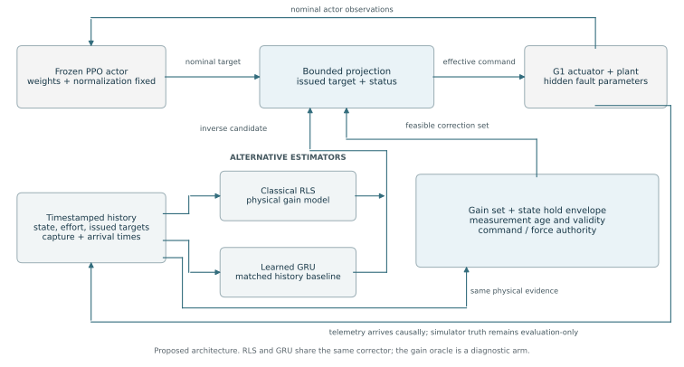
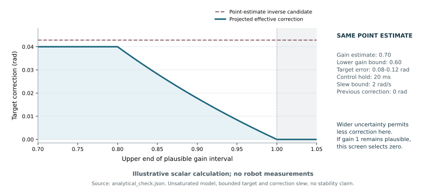

# Online Actuator Adaptation for Reliable Humanoid Locomotion

**Prasuna Chatla | pchatla@stanford.edu**

**Technical design and experimental protocol | Research proposal 0.3 | November 15, 2026**

**Decision summary.** This revision strengthens the original one-page proposal into a specific research candidate. Its method uses the range of actuator gains consistent with timestamped telemetry, possible joint motion during the next command hold, and available command authority to determine which correction is justified. The research test is whether this rule improves useful recovery while reducing harmful correction compared with a well-tuned heuristic under the same information and limits. The selected system boundary remains a frozen G1 PPO policy, an estimator, bounded position-target correction, and an execution supervisor. The four-page Fleet Robust Execution proposal emphasizes building and validating this component; this version adds a defined algorithm and the experiments needed to assess a paper claim.

**Evidence status.** The existing gain-fault wrapper and privileged feasibility gate have CPU checks [1]. This revision adds a CPU-only scalar reference and analytical illustrations: ten finite cases, two invalid-input checks, and 71 uncertainty-sweep points pass. These are not robot recovery results. The proposed estimator, integrated correction rule, GPU comparisons, learned alternatives and C++ runtime remain to be implemented or measured. The earlier 24-page engineering design remains supporting material [2].

## Abstract

A frozen locomotion policy may issue useful commands through an actuator interface whose response changes during execution. Correcting those commands requires estimating the response and deciding how much the available evidence supports intervention. Tracking error alone cannot establish an actuator change, while delayed measurements, unknown sensor scaling, weak excitation and finite command authority can invalidate a plausible inverse. This project develops an identification-aware execution layer for a simulated Unitree G1. Timestamped effort and encoder measurements define a feasible gain interval; declared drift and motion bounds propagate uncertainty through the next 20 ms command hold. A closed-form projection selects a correction subject to physical target limits, requested slew, force headroom and a conditional actuator-force error criterion. A frozen PPO actor supplies locomotion. Classical and learned history estimators share the same corrector, while actuator-randomized PPO tests whether policy reuse is preferable to learning robustness directly. Experiments separate genuine actuator changes from nuisance and sensor shifts, include sudden return to healthy actuation, and retain failures. The proposed contribution is a measured recovery-versus-erroneous-intervention benefit under a specified information and authority interface. No general stability, physical fleet deployment or publication outcome is assumed.

## Problem and objectives

Humanoid work requires useful commanded motion across changing actuation, while the execution software has only partial, delayed and sometimes misleading evidence of the change. An adapter can recover performance when a command-response mismatch is identifiable and compensable. The same adapter can degrade a healthy controller when it misreads contact, loading or sensing changes as an actuator fault, or retains compensation after the actuator returns to normal.

The research question is: **can an explicit rule linking identification uncertainty, telemetry freshness and corrective authority improve the recovery-versus-harm tradeoff over estimated inversion and a tuned heuristic gate, while preserving a frozen humanoid policy and its 20 ms execution deadline?**

Two hypotheses and one learning-comparison question make the research testable. H1: bounded true-gain correction can recover a meaningful part of the degradation in the existing gain-only gate. H2: the proposed projection improves the primary task-loss comparison over the strongest validation-tuned heuristic while meeting declared healthy-operation margins. RQ3: which approach offers the best task performance under comparable information, authority and training cost: classical estimation, learned-history estimation or actuator-randomized PPO? The comparison can legitimately favor the classical estimator or the robust policy.

The core task is walk, turn, stop and resume under a hidden actuator change. Healthy competence in every phase is checked first. Simulator localization supplies the initial route commands. The first disturbance changes proportional-servo gain, with existing damping and force limits unchanged. Asymmetric gains, drift and held-out instances extend this family. A distinct lag model, reduced torque capacity and sensor faults are separate test families with different physical limits. Initial execution remains 50 Hz policy/correction and 500 Hz physics. A C++ replay implementation measures numerical parity and runtime at matching timestamps. [1,2]

## What is stronger in this revision

| Earlier proposal commitment | Concrete addition in this research candidate |
|---|---|
| Confidence scales a bounded inverse | A feasible gain set and explicit correction constraints determine permitted intervention |
| Account for delayed telemetry | Source-time alignment and declared drift propagation quantify the effect of measurement age |
| Correct at the control tick | A state envelope accounts for motion during the complete 20 ms held command |
| Evaluate recovery from gain loss | Also test harmful adaptation under healthy nuisance changes and sudden recovery to healthy gain |
| Compare no adaptation, fixed calibration and a privileged oracle | Add estimated inversion and make a well-tuned, matched heuristic the primary method comparator |
| Add learning if useful | Replace only the candidate estimator under the same physics-derived set, then compare full robust PPO |
| Aim for a paper | State the claim, required figures, failure interpretations and evidence that would reject the claimed advantage |

The improvement is in the definition and testability of the mechanism. Set-membership estimation, inverse control and constraint filters are established techniques. A stronger paper requires the specified combination to explain and improve a real failure mode under fair comparisons. Adding terminology, more controllers, or more pages does not supply that evidence.

## Identification-aware correction

The correction rule below is the research candidate. The current known-gain simulator wrapper is the integration starting point, while the scalar reference checks only its algebra. The practical controller never receives injected gains or fault-onset labels. Its history contains arrived measurements and previously issued commands; the current command cannot be part of its own input.

### Declared physical and measurement assumptions

For one unsaturated unit-gear actuator, suppress the joint index:

$$
\tau(t)=g(t)K_p\big(z(t)-q(t)\big),\qquad K_p>0.
$$

Joint damping and force limits retain their existing definitions. Gain lies in a declared positive prior interval. Between abrupt changes, assume a declared drift bound $|\dot g|\le L_g$. Let $r_k$ be the actor's nominal target after its ordinary control-range clipping; the adapter chooses a requested offset $x_k$. Actual issued correction is

$$
d(x)=\operatorname{clip}_{\mathcal R}(r_k+x)-r_k,
\qquad z_k=r_k+d(x_k).
$$

The measurement channel supplies actual actuator effort, not merely commanded current. Effort, encoder position and the issued target must correspond to the same source timestamp. At source time $t_i$, define

$$
\phi_i=z_i-q_i^{\rm meas},\qquad y_i=\tau_i^{\rm meas}/K_p.
$$

With encoder error bounded by $b_q$, effort error by $b_\tau$, and gain at most $g_{\max}$, a valid conservative regression bound is

$$
|y_i-g_i\phi_i|\le\epsilon_i,
\qquad \epsilon_i=b_\tau/K_p+g_{\max}b_q.
$$

Bias and timestamp-alignment uncertainty require additional declared bounds. Saturated samples cannot use this unsaturated regression. Their rejection must use permitted status/measurement channels, not hidden simulator labels.

Known bounded errors support conditional set inclusion. Gaussian or heavy-tailed errors do not have finite deterministic bounds: selected envelopes then support empirical coverage statements, with violations retained and reported. Bounds are selected on development trajectories and coverage assessed on independent episodes, by fault, contact phase and measurement age. Per-sample coverage is not a trajectory-wide guarantee.

### Timestamped set-membership estimation

Each valid measurement defines an interval through two linear inequalities:

$$
\mathcal S_i=\{g\in\mathcal G_0:|y_i-g\phi_i|\le\epsilon_i\}.
$$

This formulation avoids dividing by a nearly zero target error. Weak excitation leaves a wide set. Process packets in source-time order; delayed or reordered packets require bounded-history replay, not pairing old effort with the latest target. A chronological update is

$$
\mathcal G_i=
\left(\mathcal G_{i-1}\oplus[-L_g\Delta t_i,L_g\Delta t_i]\right)
\cap\mathcal S_i.
$$

Here $\oplus$ denotes interval addition. At decision time $t_k$, propagate the latest processed set from its source timestamp $t_m$ through the entire hold $H=0.020$ s:

$$
\mathcal G_k^H=
\left(\mathcal G_m\oplus[-L_g(t_k-t_m+H),L_g(t_k-t_m+H)]\right)
\cap\mathcal G_0.
$$

Thus stale telemetry reduces corrective authority through a stated model, rather than an arbitrary age multiplier. A bounded history starting from the full prior gives predictable memory use. An RLS point estimate supplies the inverse candidate, but its covariance does not define this set. Set-membership identification and time-varying set expansion have established precedents [9-12].

An empty intersection indicates inconsistency, not proof of actuator degradation. A large innovation can arise from a gain jump, sensor error, saturation, alignment failure or an invalid model. Immediately mark the set unsupported, restart a candidate set from the full prior, and reacquire informative measurements. Persistent inconsistency triggers MODEL_MISMATCH. Recovery criteria, reset hysteresis and false-reset rates are specified before evaluation.

**Abrupt unknown jumps invalidate the drift-based inclusion before detection.** The controller cannot know that a jump occurred during an unobserved interval. No continuous certificate is claimed across that interval; detection delay, correction during that delay and resulting falls remain outcomes. Including every possible instantaneous jump in every gain set would preserve coverage but may prevent useful correction. This limitation is part of the experiment.

### Correction over a finite hold

Construct an encoder-state envelope $\mathcal Q_k^H$ covering possible $q(t)$ during the hold, using only arrived position/velocity measurements, their ages and declared motion bounds. For example, a speed bound gives a radius $b_q+V_{\max}(a_q+H)$ around the latest measured position. Tighter velocity/acceleration envelopes may reduce conservatism, but their validity must be checked; a fitted quantile is not a physical bound. Define

$$
\mathcal E_k^H=r_k-\mathcal Q_k^H.
$$

At the same possible state, the corrected actuator's error relative to nominal proportional force is

$$
E(g,e,x)=K_p\big[(g-1)e+g\,d(x)\big].
$$

At every corner of $\mathcal G_k^H\times\mathcal E_k^H$, available force headroom imposes

$$
|gK_p(e+d(x))|\le\tau_{\rm available}-m_\tau.
$$

This uses a supported force ceiling and margin, not an evaluator's hidden degraded capacity. The unsaturated comparison additionally requires checking the uncorrected faulty and ideal nominal forces against their limits. Unsupported capacity or saturation makes that comparison unavailable. Missing force authority cannot be recovered by a larger target.

The primary method also requires

$$
|E(g,e,x)|\le |E(g,e,0)|
$$

at each corner. Each inequality is an interval in effective offset $d$. Intersect them to obtain $\mathcal D_k$. The clipping map is monotone, so its preimage is also an interval. The requested-offset feasible set is

$$
\mathcal X_k=d^{-1}(\mathcal D_k)\cap[-d_{\max},d_{\max}]
\cap[x_{k-1}-v_\delta H,x_{k-1}+v_\delta H].
$$

Form an inverse candidate using the RLS gain estimate, projected into the valid current gain set, and a causal current-position estimate:

$$
\delta_k^{\rm cand}=(\hat g_k^{-1}-1)(r_k-\hat q_k).
$$

The single primary optimization is

$$
\min_{x\in\mathcal X_k}(x-\delta_k^{\rm cand})^2
+\lambda(x-x_{k-1})^2,\qquad\lambda\ge0.
$$

For a nonempty interval it has the closed-form solution

$$
x_k=\operatorname{clip}_{\mathcal X_k}
\left(\frac{\delta_k^{\rm cand}+\lambda x_{k-1}}{1+\lambda}\right).
$$

This preserves the requested/effective distinction without a generic solver. Set $\lambda$ on development data and match it across estimator comparisons. The algorithm projects toward an estimated inverse while enforcing the stated robust constraints; it does not minimize worst-case error. Worst-case modeled error is a reported diagnostic. Runtime still requires measurement.

### Conditional result and its limits

**Proposition.** Suppose gain and position remain inside the declared hold envelopes, the pure-gain model is valid, commands are unsaturated, and the optimization is feasible. Corner checks of the comparison inequality ensure that corrected instantaneous force error is no greater than uncorrected faulty force error throughout that hold, evaluated at the same state.

**Proof.** For fixed effective correction $d$, the squared-error difference is

$$
E(g,e,x)^2-E(g,e,0)^2
=K_p^2g d\,[g d+2(g-1)e].
$$

Since $g>0$, the sign of the prefactor depends only on $d$. The bracket is affine in each of $g$ and $e$ separately, so its extrema over the rectangle occur at corners. If $d=0$, the difference is zero. Otherwise the corner inequalities establish the required bracket sign everywhere. Absolute force and force-error maxima also occur at corners. Substituting the actual gain and position proves the claim.

If the gain interval includes 1, the uniform comparison permits only zero effective correction. A state envelope containing $e=0$ has the same consequence. Consequently stale data, uncertain gain or fast joint motion can eliminate certified corrective authority even when a point inverse looks promising. This explains a measurable abstention mechanism; it does not establish that abstention improves walking.

The result compares forces at the same state, not two independently evolved trajectories. It does not bound joint tracking, contact forces, falls or whole-body stability. Abrupt unseen changes, envelope violations, additive actuator effects, wrong sensor scale and saturation invalidate its assumptions.

Requested-slew limits can make the feasible set empty when a new estimate requires immediate withdrawal. Preserve the declared fallback: decay the requested offset at the configured rate and label the comparison unavailable, or invoke a separately evaluated override. Record the violation explicitly. Returning to a degraded frozen actor is not a safe-state guarantee.

### Identifiability and nuisance changes

Unknown multiplicative effort-sensor scale c changes the regression to y approximately equal to c times g times the target error. This channel alone identifies a product, not physical gain. Independently calibrated scale, a declared bounded scale set, or another validated measurement model is required. This does not assert impossibility for every possible multimodal dynamics model. Contact and external loads change motion and excitation but do not automatically invalidate a synchronized actual-actuator-force relation. Estimated effort reconstructed from inverse dynamics introduces additional contact, inertia and load assumptions. The no-effort condition therefore requires its own declared motion-history estimator or an unavailable-identification status.

An especially important test changes a degraded gain back to healthy gain without announcing the transition. A correction that was useful just before recovery may become harmful while delayed telemetry still indicates the old response. This test exposes detection and withdrawal limits directly; it is not covered by a continuous bounded-drift certificate.

## Analytical checks completed for this revision

The accompanying standard-library Python reference implements interval intersection, the exact preimage through target clipping, and the closed-form scalar projection. It checks amplitude, requested slew, force headroom and the model-force comparison at corners and sampled interior points. Ten finite cases, two explicit nonfinite-input cases and 71 uncertainty-sweep points pass. Numerical sampling complements the stated derivation; it is not a proof of all implementations or evidence of robot balance.

The table below uses illustrative parameters: $K_p=75$ Nm/rad, an estimated gain of 0.7, a 20 ms hold, requested slew 2 rad/s, and an error interval of [0.08,0.12] rad unless specified. These are synthetic calculations, not measured G1 outcomes. The inverse candidate uses the illustrative interval midpoint; integration must supply a separate causal current-state estimate.

| Case | Effective correction or status | Interpretation |
|---|---|---|
| Gain interval [0.65,0.75] | 0.0400 rad | Nonzero model-admissible correction exists; the first-step slew bound is active |
| Wider interval [0.60,0.95] | 0.00842 rad | Less certain response permits less correction |
| Interval [0.60,1.02] includes healthy gain | 0 rad | Uniform force-error comparison permits no effective correction |
| Error interval [-0.01,0.01] crosses zero | 0 rad | A held offset cannot improve every possible instantaneous force error |
| Gain [0.60,0.80], available force 9 Nm | 0.0300 rad | Supported force headroom limits the offset |
| Requested previous offset 0.08 rad; healthy gain now plausible | CONSTRAINT_CONFLICT | Immediate zero correction conflicts with the ordinary slew bound |
| Nominal force already exceeds supported ceiling | UNSUPPORTED_SATURATION | The unsaturated comparison is unavailable |
| Target upper limit 0.12 rad, nominal target 0.10 rad | 0.0200 rad effective; 0.0400 rad requested | Clipping changes the realized offset; both values must be recorded |

The early information/authority check is consequential. If valid intervals and realistic motion envelopes permit almost no nonzero correction during walking, better estimation or a smaller computation time will not automatically rescue the method. Quantify permitted correction and its overlap with useful oracle corrections before investing in learned adapters. A strict rule that never intervenes cannot earn a recovery claim. A relaxed criterion would be a separately specified variant with different claims and validation, rather than a silent post-test change.

## Deep RL and learned inference

The base PPO actor, its normalizer, observation ordering and original action-history convention remain fixed in every adapter comparison. The adapter records actually issued commands separately. Learning has three controlled roles.

First, replace the RLS point estimate used to form the inverse candidate with a history estimator. A small GRU is a proposed starting architecture, trained using simulated parameter labels and the same timestamped inputs available to the classical estimator. Both candidates pass through the same physics-derived gain set, feasible correction interval and scalar projection. The GRU does not narrow the admissible set or receive extra authority. Record how often different predictions survive projection and change the issued command. This is supervised temporal inference, not a new RL policy or online weight training. It can still test whether learned inference is useful.

Second, train a separate PPO policy with explicit actuator-gain randomization, including changes within an episode. Give it permitted observation history when history is needed, the physically allowed action envelope, and a credible training/tuning budget. Evaluate it on the same held-out scenarios and report its extra training cost. This is the direct test of learning robustness versus preserving the original actor. General domain randomization that omits the actual actuator changes is not the intended baseline.

Third, introduce residual PPO only after a measured correction-model limitation remains. Keep total correction authority, practical inputs and validation conditions comparable. If its stochastic latent is passed through the projection, PPO likelihoods refer to the sampled latent; the deterministic projection is part of the environment interaction. Failure accounting must prevent early termination from avoiding future cost. A residual that mainly circumvents a bad classical estimator or receives broader limits cannot establish a learning advantage.

If the robust full policy wins at an acceptable cost, report that result. If learned candidates are projected to the same commands, report the absence of control benefit. The project demonstrates deep RL through the behavior policy and a fair robustness comparison, while the estimator experiment cleanly separates learning-based inference from policy optimization.

## Prior work and the contribution still to be earned

| Relevant prior work | What it already contributes | Required distinction here |
|---|---|---|
| RMA [3] | Learned history adaptation for a policy trained to use an adaptation input | Work through an existing position-target actor interface and demonstrate useful behavior under the declared measurements |
| RL2AC [4] | Classical adaptive torque compensation combined with learned locomotion | Evaluate the position-target and finite-hold constraints rather than claiming the adaptive/RL combination is new |
| SAG [5] | Corrective-authority regulation for bounded residuals around frozen policies | Test explicit physical uncertainty and measurement age against strong error-driven regulation |
| TeAR [6] | Telemetry-conditioned action rectification for frozen manipulation policies | Separate genuine response changes from misleading telemetry with matched correction authority |
| SG-CPG and TAM [7,8] | Fault-severity estimation/correction and reusable history-based torque adaptation | Compare the specific information and action interfaces; a different robot alone is insufficient |
| Set-membership and robust inverse/control methods [9-12] | Fault bounds, constrained correction, online inversion, time-varying parameter sets and active identification | Establish a useful humanoid execution mechanism and evidence; do not claim these general principles as new |

SAG makes corrective authority central, while TeAR already uses telemetry to rectify a frozen policy's outgoing action. Classical fault compensation and set-membership control directly precede bounded uncertainty sets and robust inversion. These sources narrow the potential contribution to the behavior of the specified rule under realistic declared information, finite holds and constrained action access. Their plant-specific guarantees do not automatically transfer to this contact-rich humanoid system. [5,6,9-12]

The primary method baseline is a validation-tuned heuristic with the same RLS estimate, sample history, age information, actuator limits and tuning effort. A lower fixed correction cap must also be considered: the candidate could appear better simply because it acts less. For a stronger publication claim, add a faithful, interface-compatible authority-regulated residual comparison grounded in SAG or another closest method. If a reproduction changes its action space or update rule, label it an adapted baseline rather than a reproduction of the paper. Literature comparisons alone do not substitute for measured comparisons.

The contribution would be strongest if a repeatable failure mechanism is shown: a plausible point estimate encourages harmful correction after an information or actuator change; the proposed set and hold constraints limit that correction; recovery is retained where the evidence supports action; and matched ablations explain the difference. The opposite outcome must remain possible. If a tuned scalar threshold produces the same tradeoff, the more elaborate method has not demonstrated a research advantage.

## Experiments and decision criteria

The minimum method set is:

| Method | Purpose |
|---|---|
| Frozen PPO, unchanged targets | Measures existing robustness and healthy task competence |
| True-gain bounded correction | Tests whether the selected interface can compensate the fault; diagnostic information advantage |
| Estimated inverse | Same point estimator and common physical command constraints; no uncertainty-derived force-error criterion |
| Heuristic gate | Same inverse candidate and common physical limits; validation-tuned error, residual and age thresholds replace the proposed criterion |
| Identification-aware correction | Candidate method; uses uncertainty, freshness and feasible corrective authority |

The **primary method comparison is candidate versus heuristic**, not candidate versus the unadapted walker. Use identical permitted measurements, frozen checkpoint, normalizer, action-history convention and correction envelope. Common limits include amplitude, requested slew, physical target range and the same supported force-headroom checks. The heuristic does not receive the candidate's uncertainty/hold-dependent force-error nonregression filter; that filter is the mechanism being tested. Give the heuristic comparable tuning effort. Fixed initial calibration is an additional inexpensive baseline when actual initialization data are available. Leave-one-component-out ablations follow only if the complete candidate provides a meaningful advantage.

### Stage 0: inexpensive causal and analytical checks

Before renting the pod, test the inverse and uncertainty screen over synthetic states and gains, including zero target error, intervals containing unity, interval boundaries, clipped targets, force saturation and contradictory limits. Check the *effective* command after all projections. A shrinking feasible set can conflict with correction slew; record that conflict and the declared fallback rather than silently treating rate-limited withdrawal as certified.

Replay delayed packets with capture and arrival times, missing samples and sequence identifiers. Confirm that no measurement arrives before capture, no current action enters its own pre-action history, and gains or fault onset remain inaccessible to practical methods. Test analytic single-joint data first with synchronized exact effort, then with declared noise, bias and timing error. These checks establish implementation properties, not humanoid recovery. Complete artifact restoration, configuration hashing and report validation before GPU expenditure.

### Stage 1: retain the implemented feasibility gate

The current gate uses eight-second episodes, 50 Hz control and 500 Hz physics. Thirty-two paired scenarios screen healthy, healthy identity, and three common leg-gain changes (0.85, 0.70 and 0.55), each with plain and true-gain correction. The least severe passing gain advances to 128 fresh confirmation scenarios. The eight-scenario smoke profile is operational only.

Preserve its published decision rule: healthy survival at least 90%; faulty survival at least 20%; positive loss gap with either loss degradation of at least `max(0.03, 0.25 × healthy loss)` or fall-rate increase of at least 15 percentage points; recovery of at least half the healthy-to-faulty loss gap; no observed fall-rate regression; and a positive lower endpoint of the 95% paired-bootstrap interval for confirmation loss reduction. Identity, pairing, numerical validity and requested-command bounds must also pass. Raw actuator-force logging is not an audit of joint-level torque limits. The cost averages capped planar-velocity error over a fixed post-onset horizon, with failures charged the maximum cost of 4 (m/s)² for the remaining horizon. These are engineering gate thresholds, not safety certification or publication criteria.

If this gate fails, diagnose actuator authority, physical model and healthy controller competence before implementing a sophisticated estimator. Do not combine gain, lag and reduced torque capacity in this first test: the present gain inverse cannot undo all three. A negative result narrows the supported operating envelope; it does not authorize an unrelated project pivot.

### Stage 2: make identification and false compensation measurable

Use the selected compensable regime and unchanged controller. Cross actual gain changes with three telemetry conditions: exact synchronized effort for plumbing, explicitly declared noisy/delayed effort for the primary experiment, and no effort as a separately specified motion-history condition. Sensor settings are declared simulation assumptions; simulator ground-truth effort is not a substitute for a deployment channel.

Run healthy actuators under contact/friction changes, external loading and telemetry bias or staleness. Include unannounced recovery from degraded to healthy gain, as well as degradation onset. Keep these nuisance cases within the healthy controller’s meaningful task range. They test whether tracking error causes unjustified actuator correction. Include weakly excited motion and saturation as distinct information/authority limits. A no-effort condition cannot reuse the force-regression estimator unchanged.

Exact effort with nonzero target error can make gain nearly algebraically observable. Unknown effort scale and gain can instead be confounded. Show both cases rather than manufacturing difficulty with an unexplained noise level. Report predictive error, interval coverage, information availability, correction magnitude and task loss; parameter accuracy alone is insufficient. An uncertainty interval earns its nominal coverage through measurements on held-out conditions, not through the name of its covariance matrix.

The development gate requires useful task recovery with declared imperfect telemetry and a measurable recovery-false-compensation tradeoff. If point inversion already solves every case, or all methods merely turn correction off, the proposed supervisor has not earned a research claim. Investigate the supported fault/measurement regimes, while reporting that result honestly.

### Stage 3: freeze the primary test and add meaningful learning

Select one operating point per method on validation data. Register the test mixture of gain-change and healthy-nuisance scenarios, its weights, the primary fixed-horizon loss difference, healthy-regression margins and a practically meaningful improvement before opening test results. Test the candidate against the strongest validated heuristic. Report the full tradeoff curves as secondary results; do not choose a favorable operating point from the test frontier.

A quantitative research decision requires both a positive confidence bound on the primary loss improvement and an effect that exceeds the registered practical threshold. Require healthy noninferiority under the registered loss/failure margins, rather than interpreting a nonsignificant difference as equivalence. Specify those margins from task requirements and validation precision; a blanket “2% improvement” across all metrics has no physical justification. Recovering half of the observed bounded-oracle improvement can remain an online development milestone; it does not establish superiority to the heuristic. Report absolute differences before normalized recovery ratios; do not form ratios with negligible denominators.

The first learning comparison is a history estimator that feeds **the same corrector**. It isolates learned inference from action authority. A second, indispensable baseline is a complete actuator-randomized PPO actor trained across the declared fault distribution, including within-episode changes if tested. Give that actor its physical target envelope and permitted history; do not restrict it to adapter-sized residuals. Record training and tuning cost. Privileged parameters may supply training labels or a declared critic, never the deployed actor or confidence logic.

Add residual PPO only for a recorded limitation that estimation plus the fixed inverse cannot solve. Preserve the common total correction bounds, actor information and deployment timing. A weak undertrained robust policy does not establish the value of adaptation. The comparison can legitimately conclude that direct robust RL is preferable for this distribution.

### Splits, seeds and attainable precision

Assign persistent simulated instance identifiers before collecting episodes. All calibration and execution data from one instance remain in the same train, validation or test split. Hold out parameter combinations and command schedules; distinguish interpolation from genuinely outside-training-range tests. Pair methods on initial state, command, fault schedule and measurement random streams, while permitting trajectories to diverge after intervention.

Initially test one frozen policy to debug mechanisms, then at least three independently trained, matched-recipe base policies to expose sensitivity. Three policies support a robustness check, not a precise population-wide claim. Report each seed, including failed runs. Episodes from one checkpoint are not independent training replications; episodes sharing an instance also require clustered analysis for an instance-generalization claim.

For planning only, if the paired loss-difference standard deviation were 0.15 (m/s)², detecting an improvement of 0.03 (m/s)² with approximately 80% power at two-sided 5% significance would require about `((1.96 + 0.84) × 0.15 / 0.03)² = 196` independent pairs. With 128 pairs, the corresponding detectable effect is roughly 0.037. Actual planning uses validation variance, failure tails and instance clustering; these numbers are illustrative, not measured results.

Even zero failures in 128 independent trials leaves a one-sided 95% binomial upper bound of about 2.31%. That bound alone does not establish between-method noninferiority. Retain fixed-horizon failed episodes and separate numerical invalidity, physical failure, operational timeout and missing artifacts. Do not continue sampling until significance appears.

## A plausible paper and the evidence it needs

The working research title remains **Online Actuator Adaptation for Reliable Humanoid Locomotion**. If the proposed mechanism earns its claim, a more specific paper title is **When to Correct: Identification-Aware Actuator Adaptation for Frozen Humanoid Policies**. The title would describe the demonstrated result; it would not assert general humanoid safety or real fleet deployment.

The intended paper has three connected contributions. First, a precise execution rule converts a declared actuator-response set and command-hold model into a feasible correction interval at a position-target interface. Second, a benchmark separates true response changes from sensing and mechanical nuisances, including the damaging case of an actuator becoming healthy while compensation is still active. Third, comparative experiments quantify which gains come from uncertainty handling, learned inference, direct robust RL, and available command authority. The conditional force-error proposition supports the design and defines its limitations; it is not presented as a new general theorem.

| Paper figure or table | Claim it could support | Result that weakens that claim |
|---|---|---|
| Paired healthy/degraded/oracle outcomes | Compensation is possible through this interface | Oracle does not improve the chosen regime |
| Gain-set coverage and available correction versus age/excitation | Information quality controls useful authority | Sets under-cover or nearly always prohibit correction |
| Recovery versus harmful-intervention frontier | Candidate improves over tuned point/heuristic methods | Same performance after tuning, or improvement comes from extra authority |
| Fault-onset and return-to-healthy time series | Change handling and withdrawal work causally | Detector delay causes unreported harmful transients |
| Held-out instances, command phases and policy seeds | Effect persists beyond one favorable policy or gain | Improvement exists only for one seed or a tuned test mixture |
| Learned-estimator and robust-PPO comparisons | Learning or policy reuse has measurable value | Learned candidates are always projected away, or robust PPO dominates at comparable cost |
| Replay parity and batch-one timing | Component is implementable within its execution budget | Timing excludes transfers/synchronization or deadline misses |

The paper must report task loss and falls on rejected or unsupported steps as well as on accepted corrections. A bound that is valid only on a small easy subset can still be mathematically correct while having little operational value. Coverage, abstention, infeasibility and performance therefore appear together.

A rigorous technical report or workshop submission is a plausible initial publication goal if a useful mechanism and credible experiments emerge. A main-conference case would need a sufficiently distinct result, strong relevant comparisons and convincing generalization. No probability of acceptance is defensible before the experiment. Simulation-only work can be evaluated on its technical contribution; hardware evidence would add support but is not an assumed deliverable. If the tuned heuristic matches the candidate, the outcome is a reusable engineering component and a documented operating envelope, without a claim that the new rule is superior.

## Delivery, cost and the failure lessons already learned

| Milestone | Work completed before paying for the next run | Acceptance artifact |
|---|---|---|
| M0 Compensability | Restore a pinned checkpoint; CPU/smoke checks; report schema and deterministic scenario IDs | Existing 32/128 gate report with numerical validity, complete failures and manifest |
| M1 Identification and authority | Timestamped sensor adapter; synthetic estimation/reset checks; interval and projection reference | Coverage, estimation error, attainable correction, abstention and withdrawal diagnostics |
| M2 Comparative recovery | Freeze validation-selected operating points, nuisance mixture and statistical plan | Paired candidate-versus-heuristic effects with healthy-regression assessment |
| M3 Learning and generalization | Shared estimator interface; split instances; declare training and tuning budgets | Learned-history and robust-PPO comparisons, additional independent policies |
| M4 Runtime and demonstration | C++ trace harness; authoritative command schedule; figure/report generation | Walk-turn-stop-resume demonstration, parity, latency distribution and release manifest |

These are stage dependencies, not promises of completion in a fixed number of evenings. An approximate four-week development plan remains reasonable as a planning assumption, with research breadth conditional on the early measurements. The first candidate decision should not wait for new PPO training, a C++ port or a vision extension.

At the user's stated $2.50 per hour, a two-hour initial pod allocation costs $5. That is an expenditure limit for the first attempt, not an estimate that all development or experiments fit in two hours. Later run duration is estimated from measured compile, reset, step, evaluation and publication throughput. The runner must record completion or failure before a retry; long PPO jobs and extra seeds receive a separate declared budget. A wall-clock timeout is not proof that a paid pod has stopped. No pod shutdown or paid run is performed by this document release.

Previous Foresight issues are addressed as operational requirements. Pin source and environment versions instead of repairing a working venv during a paid experiment. Record exact model, normalization, observation and action-history contracts. Restore checkpoint payloads from durable storage and verify them; a Git push containing reports does not by itself preserve an ignored checkpoint directory. Save checkpoints outside ephemeral pod storage with a manifest and hashes, and verify a download before termination. Pair exogenous scenarios rather than forcing identical post-intervention robot states. Preserve failed and nonfinite episodes, and test report generation independently of training. Separate batch throughput, controller latency and rendering behavior. Complete the launcher and dry-run checks before asking for GPU time.

## Choosing between the two proposals

The proposals share a useful component boundary. The choice concerns the principal deliverable and the extra evidence required; it does not require building two unrelated controllers.

| Criterion | Fleet Robust Execution: systems emphasis | Strengthened Online Actuator Adaptation: research emphasis |
|---|---|---|
| Main deliverable | Calibration, estimator, bounded correction, fault status and measured C++ integration | The same component with a defined uncertainty/hold-aware projection and a falsifiable comparative claim |
| Strongest demonstration | Reliable component behavior, interfaces, fault handling and repeatable timing | Recovery with fewer harmful interventions under declared misleading/stale information |
| Learning content | Frozen PPO and conditional residual/robustness comparisons | Same-corrector learned inference, robust PPO and conditional residual with causal ablations |
| Main risk | Broad fleet/deployment wording exceeds what a small simulation test establishes | A simple heuristic performs equally well, or uncertainty removes nearly all useful authority |
| Completion risk | Lower if the scope stays gain-only with a working classical estimator | Higher because the additional method must beat credible alternatives |
| Publication basis | A strong systems result would need substantial integration or reuse evidence | A plausible empirical methods paper if the stated mechanism produces repeatable comparative benefit |
| Portfolio value | Particularly useful for calibration, control integration and embedded software ownership | Adds deeper discussion of inference, robust control, learning comparisons and experimental reasoning |

**Recommendation.** For the stated goal of combining robotics software ownership with deep RL and a credible research paper, select the strengthened Online Actuator Adaptation plan, subject to the inexpensive compensability and information/authority gates. Retain the Fleet execution interface and runtime deliverables as its engineering backbone. This recommendation is conditional on technical evidence, not on a claimed novelty score. The four-page Fleet proposal remains a reasonable choice when the priority is a bounded component delivery with lower research risk.

Before selection, the most useful reviewer question is: **does the specific proposed projection offer a plausible advantage over a well-tuned heuristic under the same measurements, command limits and task distribution, and can the planned experiments distinguish that advantage from conservative nonintervention?** A concrete objection to that mechanism should be resolved before training another policy.

## References

Primary sources reviewed through November 15, 2026. Literature results are cited as prior work, not reproduced measurements. Numerical examples in this proposal are labeled calculations. The predecessor paper supplies broader background and interface detail.

**[1]** Prasuna Chatla. Actuator feasibility gate and source baseline, commit aac06996b8bab2980234c4c5fb63a7c78025806f. https://github.com/pchatla-arch/anticipatory-balance/blob/aac06996b8bab2980234c4c5fb63a7c78025806f/docs/technical_notes/adaptive_execution.md

**[2]** Prasuna Chatla. Fleet Robust Execution: technical design and experimental protocol, review draft 0.2, commit d44883d2345f76709b6163e4b6b21808b456b957. https://github.com/pchatla-arch/anticipatory-balance/blob/d44883d2345f76709b6163e4b6b21808b456b957/docs/adaptive_execution/paper.md

**[3]** A. Kumar, Z. Fu, D. Pathak and J. Malik. RMA: Rapid Motor Adaptation for Legged Robots. RSS, 2021. https://ashish-kmr.github.io/rma-legged-robots/

**[4]** S. Lyu et al. RL2AC: Reinforcement Learning-based Rapid Online Adaptive Control for Legged Robot Robust Locomotion. RSS, 2024. https://roboticsproceedings.org/rss20/p060.html

**[5]** N. Jayasinghe et al. Stability-Aligned Residual Adaptation for Rapid Recovery from Dynamics Shifts. arXiv:2603.07775v2, September 2026 preprint. https://arxiv.org/html/2603.07775v2

**[6]** S. Sagar and R. Senanayake. Test-Time Adaptation of Manipulation Policies Under Actuator Degradation (TeAR). arXiv:2609.36182, 2026 preprint. https://arxiv.org/abs/2609.36182 ; author code: https://github.com/somsagar07/TeAR-Telemetry-Aware-Action-Rectification

**[7]** A. K. Kosta and K. Roy. SG-CPG: Severity-Gated Central Pattern Generators for Adaptive Quadruped Locomotion under Continuous Actuator Degradation. arXiv:2609.25687, 2026 preprint; institutional presentation: https://engineering.purdue.edu/CHIPSandAI/events_html . Scope descriptions use the verified institutional summary and indexed abstract; detailed full-text claims remain unverified.

**[8]** D. Son et al. TAM: Torque Adaptation Module for Robust Motion Transfer in Manipulation. arXiv:2606.06218; CoRL 2026 status stated on the author page. https://dongwon-son.github.io/tam-project-page/

**[9]** R. Lamouchi, M. Amairi, T. Raissi and M. Aoun. Actuator Fault Compensation in a Set-membership Framework for Linear Parameter-Varying Systems. IFAC-PapersOnLine 50(1):4033-4038, 2017. https://doi.org/10.1016/j.ifacol.2017.08.721

**[10]** M. Tanaskovic, L. Fagiano, C. Novara and M. Morari. Data-driven control of nonlinear systems: An on-line direct approach. Automatica 75:1-10, 2017. https://fagiano.faculty.polimi.it/docs/papers/LearningControl_Automatica_2017.pdf

**[11]** M. Tanaskovic, L. Fagiano and V. Gligorovski. Adaptive model predictive control for linear time varying MIMO systems. Automatica 105:237-245, 2019. https://fagiano.faculty.polimi.it/docs/papers/Adaptive_MPC_LTV_Automatica_2019.pdf

**[12]** A. Daniels et al. Active Fault Identification and Robust Control for Unknown Bounded Faults via Volume-Based Costs. arXiv:2508.12010, 2025 preprint. https://arxiv.org/abs/2508.12010

