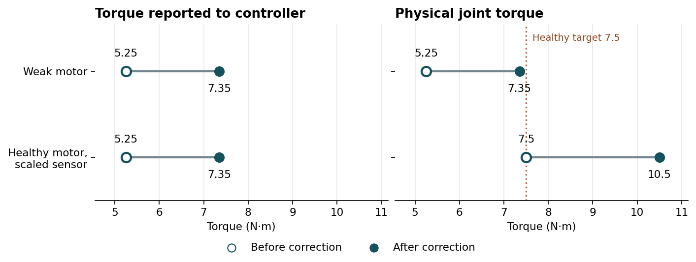

# Can the walker tell a weak motor from a weak sensor reading?

**Online Actuator Adaptation · experiment note v1.1 · November 21, 2026 (Pacific)**

A walker wants its left knee to deliver 7.50 N·m. Its effort sensor reads 5.25 N·m. Should the controller increase the position target? We reproduced two explanations for that reading in the project's simulated Unitree G1. The same adjustment helped in one and increased error in the other.



| Native MuJoCo condition | Reported torque before → after | Physical torque before → after | Final error relative to healthy torque |
| --- | ---: | ---: | ---: |
| Motor at 70% gain, calibrated sensor | 5.25 → 7.35 N·m | 5.25 → 7.35 N·m | −0.15 N·m |
| Healthy motor, sensor reporting 70% of effort | 5.25 → 7.35 N·m | 7.50 → 10.50 N·m | +3.00 N·m |

[Explore all four knee positions in the interactive exhibit](effort-scale.html). Download the HTML and open it locally, or serve it as a static page.

## What the experiment establishes

The native MuJoCo model holds the G1 at the same knee position and velocity in both conditions. The nominal proportional gain is 75 N·m/rad. With 0.10 rad of position error, a point estimate that treats the reading as a 30% motor gain loss requests extra target motion. The 2 rad/s slew limit permits 0.04 rad in the first 20 ms. We evaluate the corrected command at the same state to isolate the torque consequence. Each reading uses the project's synchronized, post-joint-limit telemetry. The test excludes clipped or invalid samples.

At an imposed state the observed effort is the product of sensor scale, motor gain, nominal stiffness and position error. Even a second reading after the adjustment gives the same apparent recovery in both conditions. A physically meaningful claim about adaptation must therefore specify sensor calibration, independent motion evidence, or the conditions under which the controller abstains. A moving robot can generate additional information through its joint acceleration, body motion and contacts. The replay does not determine whether that information suffices during walking.

Four signed position errors (−0.10, −0.05, +0.05, +0.10 rad) produced the same ambiguity to numerical precision. These are four controlled state/command cases. There were zero closed-loop episodes in this experiment. [Measured values for every case](effort_scale_probe.json)

## What should an uncertainty-aware controller do here?

If the supervisor requires zero additional instantaneous torque error on a healthy motor, it must leave the target unchanged in this example. It then accepts the 2.25 N·m shortfall on the weak motor. If instead its objective is to minimize the largest absolute torque error over these two plausible motors, a partial correction is preferable. For nominal position error e and possible motor gain multipliers g and 1, equating the opposing endpoint errors gives Δr = e(1−g)/(1+g), subject to the same command bounds.

We sent that third command through both simulated motors. At e = 0.10 rad and g = 0.70, Δr = 0.01765 rad. The weak motor produced **6.176 N·m** and the healthy motor **8.824 N·m**. The worst error was **1.324 N·m**, compared with 2.250 for abstention and 3.000 for the point-estimate correction. This supplies a concrete baseline for the proposed supervisor. Which behavior is desirable depends on the allowed healthy regression. Whole-body balance, accumulated loss and energy can change that ranking during walking.

## The next decision for the walking experiment

1. **Establish repeatability.** The previous 8-scenario-per-arm GPU smoke recorded falls in 2/8 episodes at gain 0.70 with the frozen walker and 0/8 with bounded known-gain correction. Its healthy identity check failed. The following pod restored the policies and failed during determinism setup. Before spending money on a full run, exercise the installed Warp interface and obtain paired healthy/healthy and healthy/identity traces. Keep command differences, joint state and repeat-run variation separate and in physical units. [Completed smoke and existing review](https://github.com/pchatla-arch/anticipatory-balance/pull/24) · [Later failed attempt](https://github.com/pchatla-arch/anticipatory-balance/tree/7693ebf4c4f43d968b8b30808cfb64abf57b7fd2/results/adaptive_gate_20261122T061338Z_d901f2)
2. **Confirm that correction can help.** Retain the registered 32-scenario screen and 128 fresh paired confirmation scenarios. Apply the project's fixed-horizon loss, uncertainty, falls and command-bound criteria. Select severity using screening data only. A known-gain intervention establishes correction authority. The online estimator still needs its own evaluation.
3. **Separate correction from false intervention.** Freeze the tuned heuristic and uncertainty-aware adapter before evaluation. Give each the same signals, delay, amplitude and slew limits. Pair their walk–turn–stop–resume trials across healthy walking, true gain loss, sensor-scale error with unchanged motor, and a motor returning to healthy without an onset or reset label. Measure falls and task completion on the full fixed horizon, tracking loss, harmful correction on a healthy joint, and time until excess correction decays after recovery. Include the frozen uncorrected policy. Record known-gain correction as a privileged reference. Advance an adaptation claim only if the held-out comparisons show recovery under real gain loss *and* acceptable regression under the confounds, with limits fixed by the project owner before testing.

A public demonstration should show synchronized control arms at the same fault onset, the issued correction, two or three sensor readings with their units, and the final task outcome. Preserve the unchanged-motor example even if the adapter does poorly there. The strongest version of the project is a benchmark another controls engineer can use to decide when intervention is warranted.

## Reproduce on CPU

Run from the repository root in the project's existing pinned environment.

```bash
PYTHONPATH=. JAX_PLATFORMS=cpu python scripts/probe_effort_scale_ambiguity.py --out /tmp/g1-effort-probe.json
python scripts/plot_effort_scale_probe.py /tmp/g1-effort-probe.json /tmp/g1-effort-probe.png
```

The first command uses MuJoCo 3.16.0, the project G1 assets and the existing telemetry sampler. The figure reads only the recorded values and requires Matplotlib. v1.0 adds the fixed-state replay, machine-readable record and prospective walking comparison. v1.1 adds the measured bounded minimax comparison at each of the four signed positions. Prasuna retains the experimental and publication decisions.
