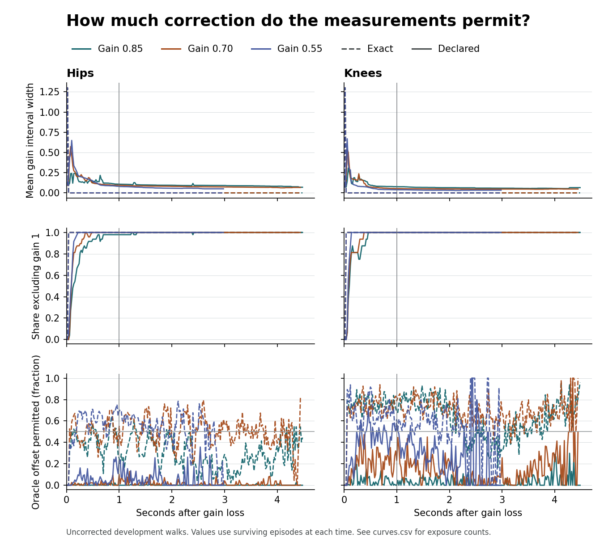

# G1 development replay for Prasuna’s decision

**Recommendation: modify.** The measurements distinguished a weakened actuator before they permitted much correction. Under the declared telemetry, the hips never reached half of the known-gain correction during the first second at any tested gain. The knees reached that level only for the most severe gain loss. The current evidence supports a narrow result on severe knee faults. The formal G1 decision remains open.

## First second after gain loss

Each percentage is the sum of the same-state oracle offset that the frozen method could deliver in the correct direction, divided by the total oracle demand. The calculation pools the surviving joints and episodes from onset through 1.00 s. The oracle knows true gain and position. The candidate receives the noisy, delayed observations specified for its channel.

| Remaining leg gain | Hips, exact | Hips, declared | Knees, exact | Knees, declared |
|---:|---:|---:|---:|---:|
| 0.85 | 40.30% | 0.29% | 71.96% | 3.95% |
| 0.70 | 47.56% | 1.28% | 69.75% | 19.18% |
| 0.55 | 56.09% | 6.21% | 64.63% | 39.42% |

At gain 0.55 the knees first crossed 50% at 0.32 s and crossed on 17 of 51 ticks. All 8 uncorrected walkers in this condition fell before the end of the episode. The curves therefore include fewer surviving walkers later in the horizon. At gain 0.70 the median first observed exclusion of healthy gain was 0.10 s for hips and 0.10 s for knees. Neither group crossed 50% in that first second.

At gain 0.70, declared hip packets exceeded the encoder bound on 30 of 14,076 valid joint measurements and the effort bound on 39. Knees exceeded those bounds on 12 and 7 of 4,692 valid measurements respectively. Exact packets had zero measured violations. These are full-trajectory counts for released valid packets while the walker remained observable. The summary also gives inconsistent resets and exposure by group.

## Evidence and reproducibility

The experiment ran six CPU cells with one frozen s1 walker, eight paired development episodes per gain, 300 steps, exact and declared channels, and no correction applied. All observed physical trajectories matched between channels at each gain. We reconstructed source ordering and every released packet independently. The declared channel combines encoder/effort noise, one to three ticks of delay and packet dropout. The individual contributions remain unmeasured. The frozen adapter uses a 10 rad/s hold-speed envelope, zero inter-step gain drift and two informative packets for reacquisition. The result depends on these assumptions.

The code and numerical kernels are those of [WP 2.2](https://github.com/pchatla-arch/anticipatory-balance/pull/39). Local execution commit `5584a40871e7e1b30a980ffa049f9b2f83debb65` and published commit `e51d2d7bdbc2e1dccd377c4d752c8b944af72477` have the same full Git tree `037bd1d85b3780e3c0761a02cee73cb66d574a68`. The evidence is a common-state development diagnostic. No held-out test or policy selection used these data.

[All curves](curves.csv) · [Summary and source hashes](summary.json) · [Capture manifest](capture_manifest.json) · [Recorded packets and episodes](dev/) · [Protocol recorded before replay](protocol.md)



From the repository root with the capture environment active:

```bash
export PYTHONPATH="$PWD" JAX_PLATFORMS=cpu
study=results/authority_replay_dev_wp13
python "$study/verify_capture.py"
python "$study/replay_authority.py" "$study/dev" /tmp/oaa-wp13-replay
python "$study/plot_authority.py" /tmp/oaa-wp13-replay
cmp "$study/summary.json" /tmp/oaa-wp13-replay/summary.json
```
