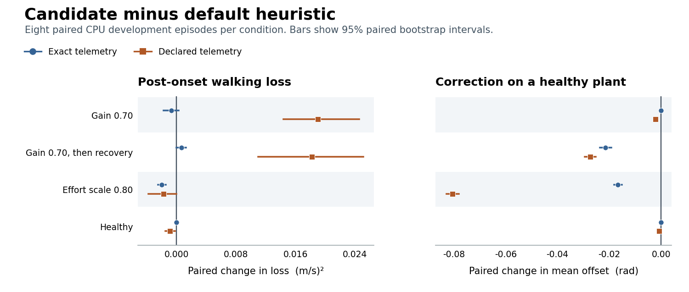

# WP 2.2 closed-loop development comparison

One frozen projection and Claude’s default heuristic ran on the CPU JAX backend with the same frozen G1 walker, shared RLS settings, commands, scenario seeds and sensor configurations. Each row uses eight paired development episodes and a 300-tick walk–turn–stop–resume schedule. The heuristic tuning study and independent evaluation remain pending.

The frozen method uses a 10 rad/s joint-speed bound, gain drift 0 per second, and 2 informative packets for reacquisition. The zero drift setting models constant gain between jumps. Time without a new measurement widens the position envelope while leaving the propagated gain width unchanged. The uncertainty settings are development assumptions.

Δ loss is candidate minus heuristic fixed-horizon planar velocity loss. Negative values favor the candidate. Each interval is a descriptive paired bootstrap over eight episodes, without multiplicity adjustment. Healthy-plant offset is the mean maximum absolute effective target correction across joints while the plant is healthy. It is a command metric. The AE-011 audit uses all observed control ticks for gain-one families and the measured gain schedule for the other families. The original harness excluded post-onset ticks in gain-one families.

| Family | Telemetry | Candidate loss | Heuristic loss | Δ loss [95% interval] | Healthy-plant offset, candidate / heuristic (rad) | Falls, candidate / heuristic |
| --- | --- | ---: | ---: | ---: | ---: | ---: |
| gain_070 | declared | 0.05003 | 0.03101 | +0.01902 [+0.01440, +0.02454] | 0.00000 / 0.00208 | 0 / 0 |
| gain_070 | exact | 0.03021 | 0.03089 | -0.00068 [-0.00175, +0.00030] | 0.00000 / 0.00000 | 0 / 0 |
| gain_070_return | declared | 0.04341 | 0.02522 | +0.01819 [+0.01101, +0.02513] | 0.00009 / 0.02749 | 0 / 0 |
| gain_070_return | exact | 0.02502 | 0.02437 | +0.00066 [-0.00000, +0.00129] | 0.00181 / 0.02331 | 0 / 0 |
| sensor_scale_080 | declared | 0.02728 | 0.02904 | -0.00176 [-0.00376, +0.00000] | 0.00294 / 0.08345 | 0 / 0 |
| sensor_scale_080 | exact | 0.02550 | 0.02747 | -0.00198 [-0.00251, -0.00141] | 0.06316 / 0.07984 | 0 / 0 |
| healthy | declared | 0.02539 | 0.02628 | -0.00089 [-0.00150, -0.00021] | 0.00000 / 0.00080 | 0 / 0 |
| healthy | exact | 0.02537 | 0.02537 | +0.00000 [+0.00000, +0.00000] | 0.00000 / 0.00000 | 0 / 0 |

The 0.005 (m/s)² loss margin is the PR #35 default recorded in the development registrations for healthy and sensor-scale families. The margin applies to walking loss. There is no preregistered threshold on offset magnitude.

All 128 raw episode rows are retained in [episodes.csv](episodes.csv). The [physical-state audit](physical_health_episodes.csv) retains both denominators and can be verified with `python audit_healthy_offset.py` using [per-tick evidence](effective_offset_ticks.npz). See [summary.json](summary.json) for invalid episodes, bounds, progress and withdrawal, [trace_summary.json](trace_summary.json) for observed effective movement and reason counts, and [comparator_reproduction.json](comparator_reproduction.json) for the comparison to Claude’s archived heuristic on the same conditions. Each family reuses its eight paired scenarios across sensor conditions. The residual gain estimate can reflect effort-sensor scale in the scale-confound family. Less correction under that condition does not identify the true gain.
