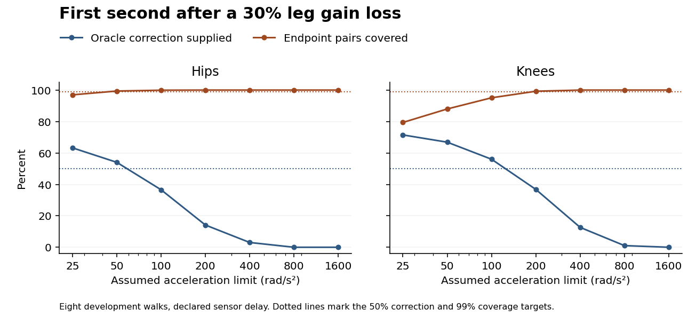

# G1 follow-up · sensor timing and usable correction

**Recommendation for Prasuna. Record the result under the declared 20–60 ms transport and keep a sensor-timing variant separate.** The development evidence supports a closed-loop test of the timing hypothesis. G2 validation and the registered comparative test remain pending.

## What changed the result

Eight uncorrected development walks per gain supplied the common states for an offline CPU replay. The experiment varied only the hold-error envelope used by the proposed projection. Both hips and knees had to reach 50% of the bounded same-state oracle correction with at least 99% coverage. Under the declared telemetry, neither velocity formula met both targets at gain 0.70 for any of the seven acceleration limits. This held in the first second and over the full observed post-onset horizon, under both definitions of endpoint coverage.

For Claude’s proposed symmetric envelope, the first-second results at gain 0.70 were as follows.

| Acceleration limit (rad/s²) | Hip correction / oracle | Knee correction / oracle | Hip endpoint pairs covered | Knee endpoint pairs covered |
|---:|---:|---:|---:|---:|
| 50 | 54.05% | 66.85% | 99.39% | 87.99% |
| 100 | 36.59% | 56.01% | 99.92% | 95.10% |
| 200 | 14.15% | 36.79% | 100.00% | 99.26% |

A smaller bound allows larger corrections at the cost of excluding observed knee positions. A larger bound protects the knee at the cost of hip correction. The same conclusion holds when coverage credits endpoints anywhere in the full hold interval. All archived control settings reproduced the original directional-authority values in the corresponding PR #40 result cells.



## Fresh paired timing experiment

Two fresh nominal s1 development walks used a 30% gain loss. Each walk was replayed under three delivery schedules with the same physical trajectory, sensor noise and drops. Joint positions were recorded at the start of each hold and after every 2 ms physics step. An independently executed ordinary rollout agreed bitwise on all 28 shared trace outputs. The fixed one-tick condition was a subsequent development probe on those same two trajectories.

The following figures use the symmetric envelope, acceleration 400 rad/s², and simulated bounded velocity error of ±0.5 rad/s. The table reports the first second after the fault. Correction is the magnitude that the rule would supply after command limits, pooled and divided by the bounded oracle magnitude on precisely the same states. No correction was physically applied during these captures.

| Packet delivery | Mean age at decision | Hip correction / oracle | Knee correction / oracle | Hip and knee sampled coverage |
|---|---:|---:|---:|---:|
| Declared, 20–60 ms | 40.20 ms | 2.87% | 13.84% | 100% in each group |
| Fixed one-tick, 20 ms | 20.20 ms | 11.21% | 49.82% | 100% in each group |
| Available at the next controller decision | 0.20 ms | 57.08% | 72.11% | 100% in each group |

Only the earliest-delivery condition crossed both numerical targets at the same setting on these walks. Across the longer post-onset interval at that operating point, earliest-delivery coverage was 99.72% at the hips and 99.58% at the knees. A dropped packet can leave even the earliest-delivery controller with an older sample. These measurements cover simulated 2 ms states, two development trajectories and one walker. They establish neither a universal motion bound nor a closed-loop walking improvement. Sensor velocity uncertainty and transport are simulated. The result does not establish that a robot can supply these measurements in time.

## Interpretation and independent checks

The historical gain prior [0.2, 1.5], zero drift between abrupt gain changes, shared RLS point estimate, physical limits, and slew limit are retained. Ground-truth actuator gain and joint positions enter only scoring. The historical CPU study and this common-state replay compare with a bounded oracle starting from zero previously issued correction. Claude’s earlier exploratory replay used a carried request and a different oracle and aggregation. Keep the studies’ ratios distinct.

The archive exposes only tick endpoints; the new observer exposes intra-hold motion as well. At gain 0.70, ideal velocity, earliest delivery and 100 rad/s², 15 of 204 knee decisions missed an observed substep. Two of those misses would have escaped endpoint checks. Endpoint pair coverage conditional on an available sample is listed alongside exposure counts and failures in the data tables.

## Evidence and reproduction

[Original protocol](protocol.md) · [Archive coverage, per group and age](coverage.csv) · [All joint authority/coverage results](joined.csv) · [Fresh protocol and source hashes](fresh/) · [Fresh per-condition results](fresh/joined.csv) · [One-tick follow-up](fresh/one_tick/) · [Proposed next experiment](next_experiment.md)

On the pinned CPU environment, use the repository tree at b814702456011974e59d9afe2568096208794b1e as PROJECT and this evidence directory as STUDY. The original signed/magnitude coverage protocols and raw packet source hashes travel with the analysis. The substep README documents the simulator and assets.

```bash
export JAX_PLATFORMS=cpu PYTHONPATH="$PROJECT"
archive="$PROJECT/results/authority_replay_dev_wp13"
python "$STUDY/score_coverage.py" "$archive" /tmp/oaa-velocity-check
python "$STUDY/replay_velocity.py" "$archive" /tmp/oaa-velocity-check
python "$STUDY/summarize.py" /tmp/oaa-velocity-check
python "$STUDY/score_fresh_authority.py" "$archive" "$STUDY/fresh" /tmp/oaa-velocity-check/fresh
python "$STUDY/score_fresh_authority.py" "$archive" "$STUDY/fresh/one_tick" /tmp/oaa-velocity-check/fresh/one_tick --transport one_tick
cmp "$STUDY/joined.csv" /tmp/oaa-velocity-check/joined.csv
cmp "$STUDY/fresh/fresh_authority.csv" /tmp/oaa-velocity-check/fresh/fresh_authority.csv
cmp "$STUDY/fresh/one_tick/fresh_authority.csv" /tmp/oaa-velocity-check/fresh/one_tick/fresh_authority.csv
```
